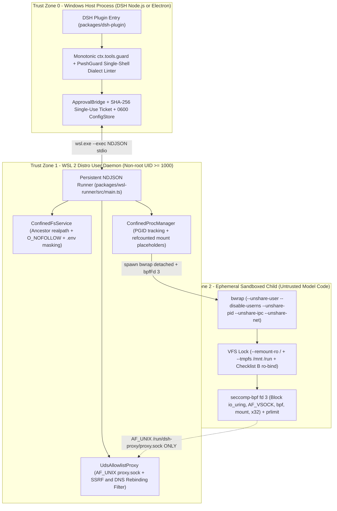

# `dsh-wsl-sandbox` 技术交接与 Linux 内核隔离机制审计白皮书

> **读者对象**：Linux 内核驱动 / 系统安全工程师、沙箱协同测试与代码审计人员  
> **目标宿主**：DeepSeek Harness (`@deepseek-ai/dsh@0.2.2-rc.5`, Cordis v4 DI 插件架构)  
> **运行底座**：Windows 10/11 + WSL 2 (Hyper-V 轻量级 Utility VM Linux 内核) + `bubblewrap` (`bwrap`) + 原生 `seccomp-bpf` (`cBPF`) + `prlimit` + Unix Domain Socket (`AF_UNIX`) 白名单代理

---

## 1. 工程背景与核心解决的问题

在 Windows 上运行 Agentic Coding 工具（特别是参数量较小、经过强化学习工具调用训练的模型如 DeepSeek V4.1 Flash）时，存在两类突出的系统工程与安全问题：

1. **宿主 Windows 用户态缺少无特权细粒度 VFS / Namespace 隔离**：模型一旦在宿主 PowerShell 中执行命令，不仅容易遍历 `C:\` / `D:\` 全盘或篡改 `.git/hooks`，还经常通过 `\\wsl.localhost\<Distro>\...` UNC 路径反向击穿 Linux 侧权限。
2. **双层异构 Shell 跳板与方言幻觉死锁（Single-Shell Purity 问题）**：模型高频在外层 `pwsh.exe` 中嵌套拉起 `cmd.exe /c "rd /s /q ... & mklink /J ..."`、混用 `pwsh.exe` (PS 7, UTF-8) 与 `powershell.exe` (WinPS 5.1, CP936) 导致引号吞噬卡死在 `>>` 二级提示符，或将 CMD 开关（`rmdir /s /q`、`2>nul`）直接喂给 PowerShell 别名（被解析为根目录 `C:\s`、`C:\q` 或创建 DOS 保留设备名文件 `nul`）。

`dsh-wsl-sandbox` 的核心架构思路是：**将代码读写、构建、测试与安全工具链收敛至 WSL 2 Linux 内核命名空间内执行**，同时在宿主机侧挂载单调不可绕过的预执行单壳方言守卫与零 Token 人工审批控制面。

---

## 2. 端到端进程拓扑与信任边界（Trust Boundaries）



### 关键信任不变量（Invariants）
1. **模型零配置写权限**：持久化配置 `$DSH_HOME/dsh-wsl-sandbox/config.json`（权限 `0600`）仅暴露给同源/环回口带 `X-DSH-WSL-Client: 1` 头的人类 HTTP 控制面（`packages/dsh-plugin/src/web-api.ts:74-89`），没有任何 `wsl_*` 工具可读写该文件。
2. **禁止 `root` 运行与禁止静默降级（Fail-Closed）**：`validateProbeAndCreateBinding`（`packages/core/src/binding.ts:296-380`）强制验证 `wslVersion === 2`、`uid > 0`（拒绝 `UID 0` 默认 root 发行版，防止容器内外 UID 映射等价于发行版 root）、非 Docker 内部发行版（拒绝 `docker-desktop` 等）以及 `sandboxReady === true`。任一探针失败直接抛出结构化 `SandboxError`，**绝不回退宿主机或无沙箱裸跑**。

---

## 3. Linux 内核隔离机制逐层剖析（供内核工程师重点审查）

### 3.1 Namespace 组合与 `--disable-userns` 防嵌套提权
代码位置：`packages/core/src/bwrap-builder.ts:201-207`

每次 `proc.exec` 拉起子进程时构造的命名空间标志：
- `--unshare-user` (`CLONE_NEWUSER`)：`bwrap` 建立单 UID 映射后执行挂载树组装，并在 `execve` 目标负载前调用 `prctl(PR_SET_NO_NEW_PRIVS, 1)` 且丢弃全部 `CAP_*`（包括 userns 内的 `CAP_SYS_ADMIN` / `CAP_NET_ADMIN`）。
- `--disable-userns`（当 `bwrap >= 0.8.0` 且内核支持时自动启用）：禁止沙箱内进程再次调用 `unshare(CLONE_NEWUSER)` 或 `clone(..., CLONE_NEWUSER)`。**内核安全意义**：历年 Linux 内核 LPE（如 `nf_tables`、`overlayfs`、`io_uring`、文件系统挂载解析器漏洞）绝大多数依赖在嵌套 userns 内重新获取 `CAP_SYS_ADMIN` / `CAP_NET_ADMIN`。同时我们的 `seccomp-bpf` 在系统调用层二次封死了 `unshare(2)` 与 `setns(2)`，形成双保险。
- `--unshare-pid` (`CLONE_NEWPID`) + `--die-with-parent` (`PR_SET_PDEATHSIG, SIGKILL`)：沙箱内进程无法枚举或信号干扰沙箱外 Runner 与用户进程；一旦父进程异常退出，内核直接 `SIGKILL` 回收子进程树。
- `--unshare-ipc` (`CLONE_NEWIPC`)：隔离 SysV IPC 与 POSIX 消息队列。
- `--unshare-net` (`CLONE_NEWNET`)：沙箱内仅有未配外网路由的隔离 `lo` 环回口，内核路由表物理上不存在通往宿主机网卡或局域网的接口。

### 3.2 VFS 挂载树构造顺序与 `--remount-ro /` 时序细节
代码位置：`packages/core/src/bwrap-builder.ts:215-356`

这是最容易写出挂载逃逸或挂载失败 bug 的地方，请重点审查以下严格顺序：
1. **顶层目录选择性只读绑定**：遍历 `/` 下顶层条目，跳过 `dev, proc, sys, tmp, run, mnt, shares`（`SKIP_TOP_LEVEL`），对其余目录执行 `--ro-bind /usr /usr` 等或 `--symlink`。
2. **WSL 特有跨界逃逸面与私有配置目录内存盘遮蔽（Checklist C + Config Isolation）**：
   - `--dev /dev`、`--proc /proc`、`--ro-bind /sys /sys`
   - `--tmpfs /tmp`、`--tmpfs /var/tmp`
   - `--tmpfs /run`：**一次性抹除 `/run/WSL/*`（WSL `init` 互操作套接字，可被用于在宿主 Windows 上免审拉起任意 `.exe`！）、`/run/dbus/system_bus_socket`、`docker.sock`、`podman.sock`、`containerd.sock`**。
   - `--tmpfs /mnt`：**一次性抹除 `/mnt/c`、`/mnt/d`（9P DrvFS Windows 全盘挂载）、`/mnt/wsl`（跨发行版共享盘）以及 `/mnt/wslg`（WSLg Wayland/X11/PulseAudio 与 `/mnt/wslg/distro` 原始发行版只读镜像）**。
   - **私有配置与凭证目录内核级遮蔽**（`SENSITIVE_HOME_CONFIG_DIRS` / `SENSITIVE_HOME_CREDENTIAL_FILES`，`bwrap-builder.ts`）：对 `$HOME/.dsh`、`$HOME/.config/dsh-wsl-sandbox`、`$HOME/.ssh`、`$HOME/.gnupg`、`$HOME/.aws`、`$HOME/.kube`、`$HOME/.docker` 自动叠加 `--tmpfs <dir> --remount-ro <dir>`，对 `.git-credentials`/`.netrc`/`.npmrc`/`.pypirc`/shell history 叠加 `--ro-bind <emptyMask> <file>`，确保沙箱内 AI 对插件自身配置、备份快照及宿主机凭证**零读取、零写入权限**。
   - 额外高危套接字发现与遮蔽（`discoverSocketsToMask`，`bwrap-builder.ts`）：自动解析环境变量中的 `SSH_AUTH_SOCK`、`GPG_AGENT_INFO`、`XDG_RUNTIME_DIR/bus`（跟随 `realpath` 同时遮蔽符号链接源与目标，解析失败则 `SANDBOX_PREPARATION_FAILED` 拒绝启动），将位于 `/home` 等非 `tmpfs` 路径下的高危 socket `--ro-bind /dev/null <sock>`。
3. **按需注入受控 UDS 代理与受控单目录 `/shares/<alias>`**：
   - 当 `networkMode === 'allowlist-proxy'` 时：校验 `proxySocketHostPath` 物理存在后，挂载 `--tmpfs /run/dsh-proxy` + `--bind <host_sock> /run/dsh-proxy/proxy.sock`。
   - 当人类在主界面配置了单目录共享时：挂载 `--tmpfs /shares` + `--ro-bind`（或 `--bind`）`<oldroot_src> /shares/<alias>`。注意 `bwrap` 在内部通过 `oldroot` 解析源路径（如 `/mnt/d/Datasets/Project`），因此即使新根 `/newroot/mnt` 已被空 `tmpfs` 覆盖，单目录挂载依然精准生效，且沙箱内 `/mnt` 仍保持完全空白。同时严禁指向配置目录、`AppData/Local/Packages` 或 WSL 发行版 VHDX `BasePath`。
4. **锁死新根 `/` 为只读**：在顶层挂载点（`/shares`、`/run`、`/mnt`）创建完毕**之后**，执行 `--remount-ro /`（`bwrap-builder.ts`），防止沙箱在 `/` 下新建任何顶层目录。
5. **绑定工作区与 Checklist B 工作区内敏感文件只读锁死**（`bwrap-builder.ts`）：
   - 在 `workspace-write` 模式下先 `--bind <workspaceRoot> <workspaceRoot>`，**随后紧接着**对工作区内的敏感配置覆盖挂载 `--ro-bind`（利用 Linux VFS 子挂载覆盖父挂载的语义使其返回 `EROFS`）：
     - 锁死文件（`packages/core/src/dangerous-paths.ts`）：`.gitconfig`, `.gitmodules`, `.bashrc`, `.bash_profile`, `.zshrc`, `.profile`, `.mcp.json`, `.ripgreprc` 等。
     - 锁死目录：`.git/hooks`, `.git/config`, `.vscode`, `.idea`, `.agents`, `.claude`, `.dsh`, `.trellis` 等。
   - **不存在路径的防创建占位与并发引用计数清理**：若 `.git` 存在但 `.git/hooks` 尚不存在，若不挂载则沙箱可在运行期间自行 `mkdir .git/hooks` 植入恶意 `post-checkout` 钩子。因此 `bwrap-builder` 将只读空文件 `--ro-bind <emptyMask> <workspace>/.git/hooks` 挂载上去；由于 `bwrap` 会在宿主机侧创建 0 字节挂载点占位文件，`ConfinedProcManager`（`packages/wsl-runner/src/proc-manager.ts`）维护了 `placeholderRefs: Map<string, number>` 引用计数，仅当并发沙箱全部退出且占位文件仍为 0 字节普通文件时才 `unlinkSync`，彻底消除并发竞态误删。
6. **`.env*` 密钥文件自动归零遮蔽**：扫描工作区深度 `<= 3` 的 `.env` / `.env.*`（显式豁免 `.env.example` / `.env.sample` / `.env.template`），统一 `--ro-bind <emptyMask> <envFile>`，沙箱读取时返回空内容而非宿主机真实密钥。

### 3.3 原生 `seccomp-bpf` (`struct sock_filter`) 字节码编译器
代码位置：`packages/core/src/seccomp-bpf.ts`

为保证零原生 C 插件编译依赖（无需 `libseccomp-dev` 或 `node-gyp`），我们用纯 TypeScript 实现了小端序 Linux Classic BPF (`cBPF`, `8 bytes/insn`) 汇编器，通过匿名临时文件打开只读 FD 3 传给 `bwrap --seccomp 3`（子进程继承后父进程立即 `close` + `unlink`，见 `proc-manager.ts`）。

BPF 过滤器执行流（请核对 `seccomp-bpf.ts`）：
1. **严格校验 `seccomp_data.arch`（偏移 `4`）**：
   - `x86_64` 仅允许 `AUDIT_ARCH_X86_64 (0xc000003e)`；`aarch64` 仅允许 `AUDIT_ARCH_AARCH64 (0xc00000b7)`。
   - 不匹配直接返回 `SECCOMP_RET_KILL_PROCESS (0x80000000)`，**彻底堵死 `int 0x80` / `IA32` 32 位兼容系统调用号混淆绕过**。
2. **封死 `x86_64` 下的 `x32` ABI（`nr >= 0x40000000`）**：直接返回 `SECCOMP_RET_ERRNO | EPERM`。
3. **无条件拦截高危内核攻击面系统调用（返回 `EPERM`）**：
   - **异步环形缓冲区高危面**：`io_uring_setup (425)`, `io_uring_enter (426)`, `io_uring_register (427)`（近年来 Linux 内核提权漏洞头号重灾区，Docker/Chromium/Android 均默认封禁，WSL 2 共享内核下必须封死）。
   - **内核扩展与调试**：`bpf`, `ptrace`, `process_vm_readv`, `process_vm_writev`, `kcmp`, `init_module`, `finit_module`, `delete_module`, `kexec_load`, `kexec_file_load`。
   - **挂载与命名空间变更（含新式 Mount API）**：`mount`, `umount2`, `pivot_root`, `chroot`, `unshare`, `setns`, `open_tree (428)`, `move_mount (429)`, `fsopen (430)`, `fsmount (432)`。
   - **内核密钥环与系统控制**：`add_key`, `request_key`, `keyctl`, `swapon`, `swapoff`, `reboot`。
4. **`socket(2)` / `socketpair(2)` 首参数（`domain`）深度过滤**：
   - 校验 `arg0` 高 32 位（偏移 `20`）必须为 `0`（防止 64 位寄存器高位脏数据绕过 32 位比较！）。
   - **无条件封禁 `AF_VSOCK (40)` -> `EPERM`**：在 WSL 2 (Hyper-V) 架构下，`AF_VSOCK` (`hv_sock`) 不经过 IP 网络栈（**不受 `CLONE_NEWNET` 网络命名空间隔离限制！**），可直接与宿主机 Hyper-V 服务及 WSL 宿主侧守护进程通信。封死 `AF_VSOCK` 是 WSL 2 沙箱最关键的内核级防逃逸补丁之一。
   - **无条件封禁 `AF_PACKET (17)` -> `EPERM`**：防止构造原始链路层套接字。
   - 在 `offline` 模式下，仅放行 `AF_UNIX (1)` 与 `AF_NETLINK (16)`（glibc `getaddrinfo` 在空 netns 内的兼容性探测），其余如 `AF_INET`/`AF_INET6` 直接返回 `EACCES`。

### 3.4 资源配额限制 (`prlimit`)、多会话进程隔离与零残留退出回收
- **资源硬上限**（`bwrap-builder.ts`）：沙箱内部入口包裹 `prlimit --nproc=256 --nofile=1024 --fsize=536870912 -- <argv>`，防止 fork 炸弹耗尽 WSL VM PID 表或单文件写爆虚拟磁盘（`512 MiB` 上限）。
- **输出流有界收集与 FD 零泄漏**（`proc-manager.ts`）：内存仅保留尾部 `256 KiB`，溢出部分写入 `0600` 临时 spill 文件（硬上限 `10 MiB`）；`finish()` 具幂等性并在 `finally` 中无条件执行，即使 `bwrap` spawn 失败也不会泄漏 `spillFd`。
- **严格会话/终端作用域与 PGID 归属校验（不误杀其他终端会话）**：
  - `ConfinedTerminalManager` 以 `${sessionId}::${terminalId}` 为键隔离并发 DSH 会话的工作目录与进程；每个活跃进程记录 `sessionId`、`terminalId` 与 `pgid`，并在环境变量中注入 `DSH_WSL_OWNER_RUNNER` / `DSH_WSL_SESSION_ID` / `DSH_WSL_EXEC_ID` / `DSH_WSL_TERMINAL_ID`。
  - 发送 `kill(-pid, SIGTERM/SIGKILL)` 前先读取 `/proc/<pid>/stat` 核验 `pgrp === pid`（防 PID 复用误杀无关人类终端），且 `invalidate` / `term.reset` 严格按 `(sessionId, terminalId)` 作用域过滤，绝不波及其他 DSH 会话或人工 WSL 终端。
  - 在 `allowlist-proxy` UDS 桥接封装中，将用户命令置于子壳 `( ... )` 内执行并在退出后显式回收 `$__dsh_bridge_pid`（`socat`/Node），彻底消除 `trap ... EXIT` 覆盖导致的孤儿 `socat` 残留。
- **插件禁用 / DSH 退出零残留与零 NTFS 文件锁**：
  - `WslTransport` 固定使用 `wsl.exe -d <Distro> --cd ~` 且 Runner 落地在 WSL 原生 `ext4`（`$HOME/.local/share/dsh-wsl-sandbox/runner/`），**对 Windows 插件目录保持零句柄占用**（支持随时卸载/删除目录，且完全兼容 WSL Manager 迁移磁盘实例与 `[automount] enabled = false`）。
  - `WslTransport` 启用 `30s` 心跳 + `180s` 租约看门狗；`dispose()` 先发 `shutdown` RPC 优雅关闭（`UdsAllowlistProxy.stop()` 主动销毁全部活跃 HTTP/CONNECT socket 并删除 UDS 文件），并注册 `process.once('exit')` 同步清理钩子（正常 `dispose()` 时注销）与 `wsl-runner` 侧 `stdin end/close` / `SIGHUP` / `3s` 硬退出保险，杜绝孤儿进程与临时目录残留。

---

## 4. 受控文件系统、UDS 代理防 SSRF、单壳守卫与单票审批

### 4.1 `ConfinedFsService` 防符号链接穿越与 TOCTOU 防护
代码位置：`packages/wsl-runner/src/fs-service.ts`
- `wsl_read` / `wsl_write` / `wsl_edit` / `wsl_glob` / `wsl_grep` 不启动完整 shell，由 Runner 在 WSL 原生 `ext4` 上直接服务（绕开缓慢的 9P 协议）。
- **祖先链 `realpath` 校验**（`canonicalizeWithinRoot`）：即使写入目标文件尚不存在，也会向上回溯至最近已存在的祖先目录执行 `fs.realpathSync`，验证其严格位于 `realpath(workspaceRoot)` 或已授权 `/shares/<alias>` 内部，阻断通过指向外部的父目录软链接写穿工作区。
- **`O_NOFOLLOW | O_CREAT | O_EXCL` 原子落盘**（`atomicWriteNoFollow`）：先 `lstat` 拒绝直接覆写符号链接目标，再以 `O_NOFOLLOW | O_EXCL` 创建同目录随机临时文件，`fsync` 后 `rename` 原子替换。

### 4.2 `--unshare-net` 下的 UDS 白名单代理与 SSRF / DNS Rebinding 防御
代码位置：`packages/core/src/uds-proxy.ts` & `packages/wsl-runner/src/proc-manager.ts`
- 沙箱内部没有外网网卡，通过轻量级 `socat`（或内置 Node fallback）在沙箱私有 `127.0.0.1:<port>` 监听并转发至 `/run/dsh-proxy/proxy.sock`。
- 沙箱外的 `UdsAllowlistProxy` 检验每一次 HTTP / `CONNECT` 请求：
  1. 校验域名是否命中内置开发源白名单（GitHub / npm / PyPI / Crates / GoProxy / Ubuntu / TUNA 等）或人工会话放行列表。
  2. **强制拦截私网/环回/链路本地/云元数据 IP**（`0.0.0.0/8`, `10.0.0.0/8`, `100.64.0.0/10`, `127.0.0.0/8`, `169.254.0.0/16`, `172.16.0.0/12`, `192.168.0.0/16`, IPv6 `::1`, `fc00::/7`, `fe80::/10`, 以及 IPv4-mapped IPv6 `::ffff:127.0.0.1`），除非命中人类显式配置的 `localLabCidrs` / `localLabPorts` 靶机网段。
  3. **防 DNS Rebinding**：直连模式下先在代理侧调用 `dns.lookup(host, { all: true })` 检查全部解析出的 A/AAAA 记录，若任一记录落入私网/环回网段立即以 SSRF 拦截。
  4. **无挂起停机**：追踪全部 HTTP 与 `CONNECT` 上下游 `net.Socket`，`stop()` 时主动销毁所有隧道并 `unlink` 套接字文件。

### 4.3 单壳纯净度与预执行方言守卫（Single-Shell Purity & Dialect Guard）
- **Windows 宿主侧 (`packages/core/src/pwsh-guard.ts`)**：
  - 先解码 `-EncodedCommand`（UTF-16LE Base64）并剥离 PowerShell 反引号 `` ` `` 与未加引号的 CMD 脱字符 `^` 混淆。
  - **L0 硬阻断**：外层 PowerShell 套内层 `cmd.exe` / `%COMSPEC%` / `--%`；混用 `pwsh.exe` 与 `powershell.exe` 子壳；交互挂起参数（`-NoExit`, `-Command -`, `Read-Host`, `pause`）；CMD 斜杠参数（`rmdir /s /q`, `del /f /q`, `move /y`）与 `2>nul` 保留名陷阱；`\\wsl.localhost\` / `\\wsl$\` 反向跨界写入；篡改 `.wslconfig` 或注册表。
  - 同时兼容 `@linxin666/dsh-win-bash` (`win_bash`) 与 `dsh-ops` (`ops_bash`) 等宿主 POSIX 工具（按 POSIX 方言检查 UNC/`.wslconfig`/`wsl.exe`/驱动变更，不误报 PowerShell 规则，`packages/dsh-plugin/src/pwsh-hook.ts`）。
- **WSL 沙箱侧 (`packages/core/src/bash-ast-guard.ts`)**：
  - 在 `wsl_bash` 执行前拦截误粘贴的 PowerShell Cmdlet（`Get-ChildItem`, `Move-Item` 等）、`$env:VAR`、`%VAR%` 以及 `.exe` 跨界调用。

### 4.4 动作哈希绑定的一次性审批票据与物理硬件/驱动单次降级锁
代码位置：`packages/core/src/approval-controller.ts` & `packages/dsh-plugin/src/approval-bridge.ts`
- 票据哈希：`SHA-256(canonicalJson({ binding, action }))`，绑定 `sessionId`、`uid`、`cwd`、`revision`、`generation`、`runnerId` 与精确命令，单次 `consume()` 后立即失效（防重放与审批调包）。
- **防 `hooksDenyBypass` 自动放行穿透**：当宿主安装了 `dsh-purge` 并开启权限补丁时，`ctx.approval.request()` 会在 `< 15ms` 内无人工交互直接合成返回放行。`ApprovalBridge` 检测到非人工瞬时合成放行且请求属于高危/越界/未知域名/物理硬件与驱动变更时，**自动将其拦截转入本插件独立人工审批队列 (`/wsl-sandbox/api/approvals`)**。
- **物理硬件与 Windows 驱动硬编码降级锁**：凡触及以下任意对象或工具——`/dev/bus/usb/NNN/NNN`、`/dev/hidraw*`、`/dev/cdc-wdm*`、`/dev/video*`、`/dev/ttyUSB*`、`/dev/ttyACM*`，`usbipd bind|unbind|attach|detach`，手机 Bootloader/线刷工具（`fastboot` 非只读子命令、`adb reboot|sideload|install|push|root|remount|shell`、`odin`/`heimdall`/`qdl`/`edl`/`mtk`），Windows 驱动与网卡变更工具（`pnputil /add-driver|/delete-driver|/install|/enable-device|/disable-device`、`devcon`、`zadig`、`Enable/Disable/Set-NetAdapter*`、`Enable/Disable/Remove-PnpDevice`），以及串口/JTAG 烧录器（`esptool`/`openocd`/`avrdude`/`dfu-util`）——均强制锁死为人工单次审批（`allowSessionRuleOption = false`），绝不允许缓存会话前缀；同时放行只读查询（`usbipd list`、`Get-PnpDevice`、`Get-NetAdapter`、`pnputil /enum-drivers`、`adb devices`、`fastboot devices`）。

---

## 5. 诚实的威胁模型与残余攻击面声明（供内核驱动专家重点评估）

我们不在安全边界上做任何夸大，请审计人员特别关注以下残余边界：

1. **共享 WSL 2 Hyper-V 内核边界（Shared Kernel Boundary）**：
   - Windows 同一用户下的所有 WSL 2 发行版运行在**同一个轻量级 Hyper-V Linux 内核实例**之上。`bwrap` + `seccomp-bpf` 提供的是进程/命名空间/系统调用过滤隔离，而非独立 Hypervisor VM 级隔离。
   - 若攻击者在允许的系统调用子集（如常规 `read`/`write`/`mmap`/`futex`/`AF_UNIX`）中触发 Microsoft WSL 2 内核 0-day 提权漏洞，理论上可突破该 WSL 2 Utility VM 内核（但仍受外层 Windows Hyper-V VMBus 虚拟化边界约束）。
   - **缓解措施**：已通过 `--disable-userns` + `seccomp` 裁剪掉 `io_uring_*`, `bpf`, `unshare`, `mount`, `fsopen`, `keyctl`, `AF_VSOCK`, `AF_PACKET`, `x32` 等最高危内核子系统。若审阅极高危未知二进制恶意样本，建议在独立硬件或独立 QEMU/Hyper-V 全虚拟化靶机中进行。
2. **WSL 2 USBIP 驱动现实边界（手机解 BL / 免驱 USB 网卡）**：
   - 微软默认 WSL 2 内核仅编入了极少数 USB 驱动模块。使用 `usbipd` 透传进 WSL 2 时，用户态 `libusb` 协议设备（如手机 ADB/Fastboot/EDL/DFU 通过 `/dev/bus/usb/NNN/NNN`）可工作，但许多手机原厂解锁工具依赖 Windows WinUSB/OEM 驱动，且许多 Windows 免驱 USB 网卡/外设在 WSL 2 默认内核中缺少对应 `.ko` 模块（无法在 WSL 2 内直接驱动）。本插件显式区分两条路径：不假设 USBIP 仅服务于串口开发板，而是允许用户在 Windows 侧以 L3 单次审批调用原厂驱动，或在 WSL 2 侧按精确节点放行。
3. **`allowlist-proxy` 模式下的白名单域名侧信道**：
   - 默认白名单包含 `github.com`、`registry.npmjs.org`、`pypi.org` 等开发基础设施。若需执行完全断网的代码审计，请将 `networkMode` 切换为 **`offline`**（此时连 UDS 代理套接字也不会挂载进沙箱，且 `seccomp` 直接封禁 `AF_INET`/`AF_INET6`）。
4. **WSL 底层 `drvfs` 自动挂载、共享配置路径与 `--terminate`**：
   - 默认状态下，`--tmpfs /mnt` 确保沙箱内的不可信进程看不到任何 Windows 盘符；若需连 WSL 宿主命名空间也彻底卸载 Windows 盘符，可运行 `bash ~/.local/share/dsh-wsl-sandbox/runner/packages/bootstrap/provision-wsl.sh --disable-automount` 后在 Windows 执行单发行版重启 `wsl.exe --terminate <当前发行版名称>`（不伤及其他 WSL 会话）。注意 `/etc/wsl.conf` 与 `%USERPROFILE%\.wslconfig` 与 Windows WSL Settings / WSL Manager 共用，本插件绝不静默修改。

---

## 6. 代码逐模块审计索引表（Reviewer Checklist）

| 审计重点模块 | 核心源码文件 | 建议重点核查点 |
| :--- | :--- | :--- |
| 会话绑定、共享路径与设备节点校验 | `packages/core/src/binding.ts` | `UID > 0` 强校验；`validateWorkspaceRoot` / `validateShareEntry` 对 `C:\`/`D:\`/`AppData`/`.dsh`/`.ssh`/`.wslconfig` 拒绝逻辑；`validateDeviceNode` 对 USB/HID/CDC/video/serial 显式白名单 |
| `bwrap` VFS 挂载树与配置遮蔽 | `packages/core/src/bwrap-builder.ts` | `--tmpfs /mnt` 与 `/run` 遮蔽；`$HOME` 下 `.dsh`/`.config/dsh-wsl-sandbox`/`.ssh` 等 `--tmpfs --remount-ro` 遮蔽；`--remount-ro /` 顺序；Checklist B 与 `.env*` 遮蔽 |
| 原生 `seccomp-bpf` 字节码 | `packages/core/src/seccomp-bpf.ts` | `OFF_ARCH` / `X32_SYSCALL_BIT` / `OFF_ARG0_HI` 边界校验；`io_uring_*` 与 `AF_VSOCK (40)` 拦截 |
| 沙箱子进程、多会话隔离与零残留回收 | `packages/wsl-runner/src/proc-manager.ts`<br>`packages/wsl-runner/src/pty-manager.ts`<br>`packages/wsl-runner/src/main.ts` | `bpfFd` 继承后即关即删；`${sessionId}::${terminalId}` 隔离；`/proc/<pid>/stat` PGID 归属校验；子壳 UDS bridge 回收；`spillFd` 幂等关闭；`stdin end/close` + `3s` 硬退出看门狗 |
| 多发行版 / WSL Manager 发现与零锁传输 | `packages/dsh-plugin/src/wsl-discovery.ts`<br>`packages/dsh-plugin/src/wsl-transport.ts`<br>`scripts/stage-wsl-runner.mjs` | UTF-16LE `wsl.exe -l -v` + 只读 `Lxss` 注册表合并（支持迁移 VHDX）；`isInsideLxssBasePath` 防护；`--cd ~` + 原生 ext4 tar 部署（零 Windows NTFS 锁）；`30s` 心跳 + `shutdown` RPC + `exit` 同步钩子 |
| 受控文件读写与防软链逃逸 | `packages/wsl-runner/src/fs-service.ts` | `canonicalizeWithinRoot` 祖先链 `realpath`；`atomicWriteNoFollow` 的 `O_NOFOLLOW | O_EXCL` |
| UDS 代理与防 SSRF / 隧道零泄漏 | `packages/core/src/uds-proxy.ts` | `PRIVATE_IPV4_CIDRS`、`::ffff:` IPv4 映射地址与 `dns.lookup` 全记录核验；`activeSockets` 全追踪与 `stop()` 快速撕毁 |
| 单壳纯净度、硬件与驱动守卫 | `packages/core/src/pwsh-guard.ts`<br>`packages/core/src/bash-ast-guard.ts` | UTF-16LE `-EncodedCommand` / 反引号 / `^` 反混淆；嵌套 `cmd` / `powershell.exe` / UNC 拦截；手机 `fastboot`/`adb` 与 Windows `pnputil`/`devcon`/`NetAdapter` 单次审批锁 |
| 审批单票状态机与防绕过桥接 | `packages/core/src/approval-controller.ts`<br>`packages/dsh-plugin/src/approval-bridge.ts` | `SHA-256` 动作绑定；`usedGrants` 一次性消费；`< 15ms` 合成审批检测；硬件与驱动单次降级锁 |
| 配置权限加固、插件路由与资源管理器门禁 | `packages/dsh-plugin/src/config-store.ts`<br>`packages/dsh-plugin/src/web-api.ts` | `0700`/`0600`/`0400` + Windows `icacls /inheritance:r`；防 `backupDir` 指向配置目录或 VHDX 路径；`isSameOriginOrLoopback` 防 CSRF；`open-explorer` 无壳白名单 |

---

## 7. 内核与沙箱实机一键复现实验指令

审核人拿到仓库后，在任意安装有 `bubblewrap`、`socat`、Node 22+ 与 Python 3 的 Linux 或 WSL 2 环境中，可直接运行以下命令验证真实内核拦截、多会话隔离与零残留回收效果：

```bash
# 1. 运行全量自动化测试套件（52 项测试：含真实 Linux 内核 bwrap + seccomp + 配置遮蔽 + 多会话隔离 + 零残留回收 + UDS 代理 + Top-27 插件兼容）
npm test

# 2. 运行按档位分级的内核隔离、配置遮蔽、USB/驱动能力与 Codex 工具链实机探针
node dist/packages/bootstrap/src/doctor.js --profile standard
node dist/packages/bootstrap/src/doctor.js --profile universal --json

# 3. 单独运行真实 Linux 内核沙箱逃逸阻断、多会话隔离与零残留测试
npm run test:linux-sandbox

# 4. 在 Windows + WSL 2 实机上运行端到端跨界验收脚本（自动探测已安装或 WSL Manager 迁移实例，零 /mnt 依赖）
pwsh -File ./tests/windows-wsl-verify/verify-wsl2.ps1
```

