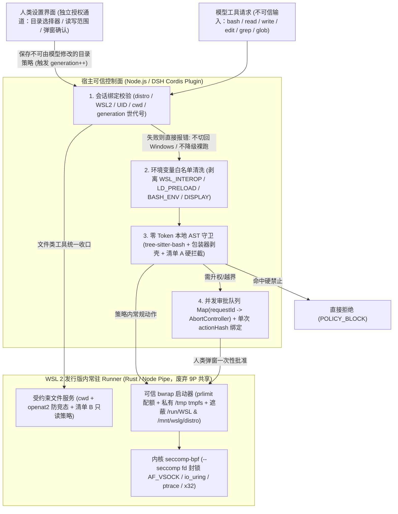

# DeepSeek Harness (DSH) WSL 后端与 Codex 级 Linux 沙箱：架构设计、开源调研与原文归档

> **整理日期**：2026-11-23  
> **核心目标**：为 Windows 下的 **DeepSeek Harness (`dsh`)** 构建/改造一个真正可靠的 **WSL 2 执行后端与 OS 级命令沙箱**——既解决 DSH 在 Windows 上强绑 PowerShell (`pwsh`) 与 `sandbox-windows-acl` 导致“模型不会用 PowerShell、低完整性标签污染工作区、管不住 WSL 内核进程”的痛点，又在不依赖昂贵云端 LLM Auto-review（零额外 Token 消耗）的前提下，对齐 **OpenAI Codex**、**Anthropic `sandbox-runtime`**、**Google `gemini-cli` / `CaMeL` / `nsjail`** 与 **OpenCode** 的多层防护体系。

## 目录导航

- [一、DSH 官方底层架构与社区 WSL 插件生态调研](#一dsh-官方底层架构与社区-wsl-插件生态调研)
- [二、对 GPT 两份调研文档的评审与 7 个工程排雷](#二对-gpt-两份调研文档的评审与-7-个工程排雷)
- [三、Google 侧安全研究与五大开源实现扒取清单](#三google-侧安全研究与五大开源实现扒取清单)
  - [3.1 Google 侧架构研究与工程实践](#31-google-侧架构研究与工程实践)
  - [3.2 清单 A：危险命令、递归剥壳、禁止自动放行前缀与路径提取](#32-清单-a危险命令递归剥壳禁止自动放行前缀与路径提取)
  - [3.3 清单 B：工作区内强制只读文件、敏感目录与密钥遮蔽](#33-清单-b工作区内强制只读文件敏感目录与密钥遮蔽)
  - [3.4 清单 C：WSL 2 `bwrap` + `seccomp-bpf` 内核防线对照表（对比 `Big-Dao` 现状）](#34-清单-c-wsl-2-bwrap--seccomp-bpf-内核防线对照表对比-big-dao-现状)
- [四、目标改造架构设计与落地路线图](#四目标改造架构设计与落地路线图)
- [附录 A：GPT 原文《WSL 后端与命令沙箱：实现规格、源码导读和验收手册》（一字未动原样转录）](#附录-agpt-原文wsl-后端与命令沙箱实现规格源码导读和验收手册一字未动原样转录)
- [附录 B：GPT 原文《Codex 的 WSL 执行防护：公开源码导读与 DSH 插件设计笔记》（一字未动原样转录）](#附录-bgpt-原文codex-的-wsl-执行防护公开源码导读与-dsh-插件设计笔记一字未动原样转录)

---

## 一、DSH 官方底层架构与社区 WSL 插件生态调研

### 1.1 DSH 官方底层接缝（`deepseek-ai/deepseek-harness`）

通过检查官方仓库 [deepseek-ai/deepseek-harness](https://github.com/deepseek-ai/deepseek-harness)（`master` 分支）的 `packages/sandbox`、`packages/shell` 与 `packages/ssh`，确认官方扩展点如下：

1. **为什么 Windows 原生模式痛点多**：
   - `packages/shell` 默认在 Win32 层用 `pwsh-sandbox` 替换 POSIX `bash-sandbox`，底层绑定 `packages/sandbox/sandbox-windows-acl`。
   - `sandbox-windows-acl` 使用 Windows 受限令牌（`WRITE_RESTRICTED`）、Capability SID Allow ACE、父目录删除拒绝 ACE 与低完整性标签（Low Mandatory Integrity Level）限制写操作，属于 `partial` 级别隔离（读不隔离、硬链接可别名、与 Cygwin/MSYS2 不兼容、且容易将低完整性标签污染到目录；更无法穿透约束 `wsl.exe` 后面的 Linux 内核进程或 9P UNC 共享）。
2. **官方标准的跨环境后端范式（`packages/ssh`）**：
   - 官方通过 `packages/ssh` 演示了如何替换整个执行世界而不改上层 Agent 循环：
     - `ssh` (`ctx.ssh`)：管理连接与辅助进程生命周期；
     - `ssh-helper-runtime`：在远端 POSIX 宿主部署常驻 Helper（无需目标预先安装工具链）；
     - `fs-ssh` (`ctx.fs`)：把路径 `resolve()`、读取和带 `sandboxPolicy` 的原子修改（`fs.patch` / `fs.delete` / `fs.move`）全部委派给远端 Helper，`processPath()` / `fileUrl()` 保持远端命名空间（`processPathFromHostPath()` 返回 `undefined`）；
     - `subprocess-ssh` (`ctx.subprocess`)：负责可执行文件解析、普通子进程、fd 7 控制信道与持久 PTY 终端；
     - `sandbox-ssh` (`ctx.sandbox`)：将 `confine(argv, policy, signal)` 转发至远端本地沙盒（如 Linux `bwrap`/`Landlock`）并返回 `enforcement` 与拒绝事实。
   - **关键收益**：只要接管 `ctx.fs`、`ctx.subprocess`、`ctx.sandbox`（或在其上的隔离 `ctx.shell`），上层直接挂载官方 `@deepseek-ai/dsh-bash-sandbox` 和 `ctx.sandboxPolicy`，就能白嫖 DSH 原生 `read-only` / `workspace-write` / `danger-full-access` 三档策略与越界提权审批 UI。

### 1.2 社区市场排查与 3 个完整 WSL 后端候选对比

调研了 `dsh-plugin.org`（全库 27,238 个插件，`q=wsl` 158 条）、`dsh.so`（全库 32,440 个插件，`q=wsl` 122 条）、`ohdsh.com`（3,304 个插件，43 条匹配 `wsl`）与 `deepseekplugins.com`（30 个精选，0 条 WSL）。**目前没有任何现有插件开箱即做到 Codex 级完整防护**；在社区上百个插件中，真正替换 DSH 核心底层接缝（而不只是塞入工具）的完整后端候选有 3 个：

| 仓库 / npm 包 | Star / Fork / 提交 / 更新 | 接管的 DSH 核心接缝 | 文件与执行通信底座 | 现有沙盒与防护能力 | 综合评估与已知缺口 |
| :--- | :--- | :--- | :--- | :--- | :--- |
| **[Big-Dao/dsh-plugin-wsl-env](https://github.com/Big-Dao/dsh-plugin-wsl-env)**<br>`dsh-plugin-wsl-env@0.27.0` | **12★** / 0 / **587 commits** / 50 tags<br>2026-11-21 更新（MIT） | Root 平面禁用替换 `subprocess`（`WslSubprocessRuntime`）、`directory-picker`、`fs-sandbox`（`WslRoutingFileSystem`）、`tool-working-directory`；并在隔离 `preset-wsl` 挂载 `ctx.shell`（`WslShellExecutor`）、`ctx.fs`（`WslFileSystem`）、`tool-bash`（禁用 `tool-pwsh` 与 `applyPatch`） | **彻底废弃 9P 共享**（启动时拒绝 `substrate: "share"`）；WSL 内常驻原生 **Rust Agent**（`agent/native/linux-{x86_64,aarch64}`，带 `wsl-agent.sh` 兜底）走管道通信 | **有真内核沙盒**：WSL 内 `bwrap` + 每会话持久 `systemd` user scope；文件写操作由独立 `bwrap` 受限 Agent 执行（fail-closed）；`socket-isolation.ts` 封禁 D-Bus / Docker / Podman / containerd / cri-o / k3s socket；支持 `--tmpfs /run/WSL` 与 `--tmpfs /mnt` | **工程完成度断层第一**，已解决大仓 9P 卡顿、软链、GUI 终端跳转等脏活。<br>**缺口**：无 `seccomp-bpf`（未封 `AF_VSOCK` / `io_uring` / `ptrace`）、缺 `--unshare-net`/`--unshare-ipc`/`--unshare-user`/`--new-session`、未单独遮蔽 `/mnt/wslg/distro`、无工作区内 `.git`/`DANGEROUS_FILES`/`.env` 只读锁、强依赖 `systemd`；另有开放 Issue `#39`（DSH `0.2.2-rc.3` 启动时报 `subprocess` 注册冲突）与 `#37`（内置 Open in app 提示无 Host 路径） |
| **[dsh-wsl-workspace-maintainers/dsh-wsl-workspace](https://github.com/dsh-wsl-workspace-maintainers/dsh-wsl-workspace)**（原 `6mikao9`）<br>`dsh-wsl-workspace@0.7.13` | **124★** / 22 / 163 commits / 11 tags<br>2026-11-07 更新（MIT） | 在隔离 WSL Preset 变体中替换 `ctx.fs`、`ctx.shell`、`ctx.sandbox`；带侧边栏 `W` 按钮与“Add WSL workspace”弹窗 | **旧底座**：文件读写经由 Windows `\\wsl.localhost\...` **9P 共享**（遇 Linux 软链接退回调 `wsl.exe readlink -f`），每次 Bash 调用重新 `spawn wsl.exe` | **Shell 基本裸奔**：`WslSandboxProvider` (`src/host/wsl-sandbox.ts`) 为空壳，原样放行 `argv`（`enforcement: 'partial'`）；仅在 `src/fs.ts` 对 `read/write/edit` 检查 `writableRoots` | **星数最高、UI 体验最成熟**；但 9P 扫大仓库极慢（README 实测还会因轮询抢 WSLg 焦点），且 Bash 层无隔离 |
| **[stallenlu/dsh-wsl-suite](https://github.com/stallenlu/dsh-wsl-suite)**<br>`dsh-wsl-suite@0.1.12` | **4★** / 2,687 下载（`dsh.so` L5 金牌低风险） | 替换隔离域内的 `ctx.fs`、`ctx.shell`，UI 直接复用 `dsh-wsl-workspace` 侧边栏设计 | **轻量新底座**：WSL 内常驻单进程 `node agent.mjs`，走 JSON-lines 管道（实测比 9P 快 1～2 个数量级：`stat` 0.20ms vs 4.3ms、`glob` 64,625 文件 0.59s vs 44s） | **防护较弱**：尚未做深度 `seccomp`/工作区元数据锁等 Codex 级防护 | **最干净的极简骨架**：不绑 `systemd`、无 9P 轮询包袱，适合从零/轻量重构 |

### 1.3 其他常见 WSL 相关插件归类排雷（不适合作为底层后端基底）

- **仅在 Windows 会话外挂 `wsl_bash` / `shell` 工具（未替换 `ctx.fs` 与工作区）**：
  - [MAXeaglet/dsh-bash-terminal](https://github.com/MAXeaglet/dsh-bash-terminal)（24★，9 月停更）：增加 `shell`/`terminal` 工具，WSL 无沙盒（`wsl-isolation`），Git Bash 无沙盒。
  - [XINY11451/dsh-wsl](https://github.com/XINY11451/dsh-wsl)（`dsh-wsl-tool@2.2.6`，15★，224 commits）：暴露 10 个独立 `wsl*` 工具，**明确声明运行在 DSH 沙盒之外**，仅在 `lib/guard.js` 做了极高质量的**确定性危险命令正则/词法拦截列表**（已在第 3.2 节完整扒取）。
  - [zimzaza4/dsh-bash-win](https://github.com/zimzaza4/dsh-bash-win)（13★）与 [Dinosaur-MC/dsh-win-multi-bash](https://github.com/Dinosaur-MC/dsh-win-multi-bash)（2★，210 commits）：两者都为 `wsl_bash` 实现了真实的 WSL 内 `bwrap` 沙盒并接入了 `ctx.approval` 升权弹窗与 Job 升格机制，但均保留 Windows `pwsh` 与 `ctx.fs` 不动，属于“多工具插件”而非“WSL 工作区后端”。
- **偏重交互桥接 / 整套远端实例嵌入**：
  - [TGWgulugu/dsh-wsl-bridge](https://github.com/TGWgulugu/dsh-wsl-bridge)（3★，v0.4.9）：提供持久 `wsl_bash` 与 `WSL` 会话模式。
  - [Han-1413141/dsh-wsl-native](https://github.com/Han-1413141/dsh-wsl-native)（4★，v0.7.0）与 [Lee-Eee-Eee/dsh-remote-dock](https://github.com/Lee-Eee-Eee/dsh-remote-dock)（3★，v0.1.5）：直接在 WSL 内再安装并启动一套完整 Linux DSH 实例，将 Web UI 嵌回本地窗口，适合双端独立运行而非轻量插件改造。
- **已废弃或不含 WSL**：
  - [Rycar1/dsh-for-wsl](https://github.com/Rycar1/dsh-for-wsl)（0★，仅 9 commits，8 月停更，要求 Full access）。
  - [LAN-TINA-WS/dsh-windows-shell-policy](https://github.com/LAN-TINA-WS/dsh-windows-shell-policy)（6★，仅支持 Git Bash / MSYS2 / Cygwin，不支持 WSL，Issue `#2` 受限于 Win32 error 5）。
  - [wepar1212/dsh-wsl-workspace](https://github.com/wepar1212/dsh-wsl-workspace)（1★，5 commits，8 月停更的早期版本，无沙盒）。

### 1.4 基底选型结论

- **路线 A（首选，最省成本且功能最全）**：以 **`Big-Dao/dsh-plugin-wsl-env`** 为基底——先本地安装实测并修掉 `0.2.2-rc.3` 兼容性冲突（Issue `#39`）与 `systemd` 强绑定，再把第 3 节扒取的 Codex + Anthropic + Google + `dsh-wsl` 安全规则合入其 `bwrap.ts` / `socket-isolation.ts` / `sandbox.ts` 与 Shell 前置守卫层。
- **路线 B（备选，极简可控）**：若实测后觉得 `Big-Dao` 59 个文件包袱过重，则以 **`stallenlu/dsh-wsl-suite`** 的 JSON-lines 常驻管道骨架 + 官方 `packages/ssh` 契约为基础，外挂自研轻量 Linux Sandbox Runner。

---

## 二、对 GPT 两份调研文档的评审与 7 个工程排雷

GPT 提供的两份文档（完整原文见**附录 A** 与**附录 B**）在**信任边界拆分**（模型执行面 vs 人类目录授权面分离）、**动作哈希 + 世代号单次审批绑定**、**基于 fd / `openat2` 防 TOCTOU 路径竞态**，以及识别出 Codex 针对 WSL 的 **`/run/WSL` 与 `/mnt/wslg/distro` 遮蔽** 上非常扎实；但若直接照搬在 DSH 上落地，存在以下 **7 个必须避开的工程坑**：

1. **【致命可用性 Bug】文档 1 §4.2 把 `:tmpdir` 与 `:slash_tmp` 设为 `"deny"`**
   - 原文示例写了 `":tmpdir" = "deny"` 与 `":slash_tmp" = "deny"`。在 Linux 中完全封死 `/tmp` 会导致 Bash Here-Doc (`<<EOF`)、`mktemp`、`gcc`、`cargo`、`npm`、`pip`、`pytest`、`git` 大面积失败。
   - **修正**：绝不能禁 `/tmp`，而应在 `bwrap` 中使用 `--tmpfs /tmp --tmpfs /var/tmp` 挂载**单次执行/单会话私有的内存临时盘**——既满足工具链正常运行，又与宿主 `/tmp`（尤其是高危的 `/tmp/.X11-unix`）物理隔离，进程退出自动销毁。

2. **【架构耦合死板】两份文档均建议外调 `codex sandbox --permission-profile <name> -- ...` CLI**
   - 缺点一：强迫用户必须在 WSL 内额外安装并维护一套 OpenAI `codex` 二进制与外部静态 TOML 配置；缺点二：DSH 的 `ctx.sandbox.confine(argv, policy)` 是每次调用动态传入 `read-only` / `workspace-write` 与 `writableRoots` 的，外调固定名字的静态 profile 会废掉 DSH 原生权限档切换与单次提权能力。
   - **修正**：直接参考 Google `gemini-cli` 与 `openai/codex` 开源实现，在 DSH 插件内部用系统 `bwrap --seccomp <fd>` + 动态挂载参数原生生成隔离，**零外部 `codex` 依赖**且完美兼容 DSH 动态权限。

3. **【并发冲突 Bug】文档 1 §9 参考代码 `wsl-control-plane.mjs` 使用全局单槽 `let pending`**
   - 代码中 `if (pending) fail('REVIEW_BUSY')` 假设同一时刻只能有一个审批请求。现代大模型（包含 DeepSeek）经常在同一轮并发发起多个工具调用，并发走到审批分支时第二个会直接异常失败。
   - **修正**：改为按 `requestId` 索引的 `Map<string, AbortController>` 管理多路并发审批，`invalidate()` 时遍历整个 Map 统一 `abort()`。另外原文 `absolute()` 中的 `!value.endsWith('/')` 校验也会误杀根目录 `/`（虽一般不直接执行 `/`，边界条件需注意）。

4. **【入参假设脱离 Shell 实际】文档 1 §9 `parseAction` 假设模型传入拆好的绝对路径 `argv`**
   - DSH 的 `bash` 工具下发的是 `bash -c "<复合脚本>"`（充满管道、子 shell、`$()`、重定向）。控制面只核对 `argv[0]` 为 `/usr/bin/bash` 不具备语义拦截作用，必须在前端或 Runner 层引入 **`tree-sitter-bash` AST 解析** 与包装器递归剥壳。

5. **【WSL 2 漏掉的内核级与图形逃逸通道】**
   - 两份文档抓住了 `/run/WSL` 和 `/mnt/wslg/distro`，但漏了 3 个同样致命的 WSL 2 通道（其中第一条已从 Codex `seccomp.rs` 源码实锤）：
     1. **`AF_VSOCK` + `io_uring` + x32 ABI 系统调用逃逸**：哪怕用 `--tmpfs /run/WSL` 遮蔽了目录，WSL 2 内核仍允许 `AF_VSOCK` 通信；且 `io_uring` 可不经过 `socket()` 直接创建 `AF_VSOCK`。必须由 `seccomp-bpf` 封死。
     2. **`/mnt/wsl` 跨发行版共享 tmpfs**：所有 WSL 2 发行版共享的挂载点，默认必须遮蔽。
     3. **WSLg 图形与音频 Socket（`/mnt/wslg/.X11-unix`、`/tmp/.X11-unix`、`$DISPLAY`、`$WAYLAND_DISPLAY`、`$PULSE_SERVER`）及抽象 Unix Socket**：X11 协议无客户端隔离，必须遮蔽并清环境变量；抽象命名空间 Unix Socket 归 Network Namespace 管，必须配合 `--unshare-net` 才能封住。

6. **【过度烧钱坑】文档 2 §三 大篇幅讨论云端 LLM Auto-review**
   - 每次越界或敏感命令都调云端大模型做审查，不仅耗时、还会消耗额外双倍 Token。
   - **修正**：采用 **OS 内核硬隔离（`bwrap` + `seccomp-bpf`） + 本地零 Token AST 危险命令拦截（< 1ms） + 仅真越界时走 DSH 原生人工确认弹窗**，彻底省掉多余模型调用成本。

7. **【过度设计与权限越界】文档 1 §5 & §6.2 建议开发修改 `/etc/wsl.conf` 与 `/etc/fstab` 的提权管理后台**
   - 一旦在插件里引入修改 `/etc/wsl.conf` 和 `/etc/fstab` 的功能，就必须在 WSL 内申请 `root`/`sudo` 并处理跨发行版配置并发、备份回滚与重启，工程量和风险成倍放大。
   - **修正**：彻底砍掉系统配置编辑器，所有 `/mnt` 隐藏与 `/shares/<别名>` 映射**全部在每次启动进程时通过用户态 `bwrap` mount namespace 动态构造**，零 `sudo`、零发行版重启、零宿主配置污染。

---

## 三、Google 侧安全研究与五大开源实现扒取清单

### 3.1 Google 侧架构研究与工程实践

1. **Google DeepMind `CaMeL` 框架（*Defeating Prompt Injections by Design*, arXiv:2503.18813）**
   - 核心思想：不能依靠提示词或另一段不可靠的模型推理来防御 Prompt Injection，而应通过**显式能力边界（Capabilities）与数据流溯源（Data Provenance）**做结构性阻断——当工作区包含外部不可信文本（开源仓库代码、网页、Issue）时，执行器能力上限由确定性策略锁死，工具输出内容绝对不能驱动权限扩充。
2. **Google `gemini-cli`（`google-gemini/gemini-cli`）的工程落地与 CVE 教训**
   - **零外部二进制的纯 TS `bwrap --seccomp <fd>` 架构**（`packages/core/src/sandbox/linux/{LinuxSandboxManager.ts, bwrapArgsBuilder.ts}`）：直接在 Node/TS 层按当前 CPU 架构生成 `seccomp.bpf` 机器码写入临时文件（`os.tmpdir()/gemini-cli-seccomp-*`），通过文件描述符喂给系统 `bwrap --seccomp <fd>`，无需安装重型容器或第三方 CLI。
   - **合法二进制的危险参数拦截**：重点检查 `git` 等工具的越界参数（如 `git -C <外部目录>`、`git --work-tree=...`、`git config` 修改 `core.fsmonitor`/`core.sshCommand`），绝不对 `git` 做整词白名单放行。
   - **环境变量投毒与预处理防护（CVE-2026-12537 教训）**：绝不能在进入沙盒前从不受信任的项目目录读取 `.env` 或配置并注入宿主/Runner 环境变量；进入沙盒前必须清洗环境变量白名单，阻断恶意仓库通过 `NODE_OPTIONS`、`LD_PRELOAD`、`BASH_ENV`、`PROMPT_COMMAND`、`GIT_SSH_COMMAND`、`PYTHONPATH` 等变量在沙盒初始化或普通命令执行前劫持进程。
   - **Conseca 策略设计**：在 `packages/core/src/policy/policies/conseca.toml` 等策略体系中，按 `plan` / `read-only` / `write` / `yolo` 分层配置 `Priority` 决策与 `safety_checker`。
3. **Google `nsjail` 的资源防爆补充（补齐 `bwrap` 短板）**
   - `bwrap` 只管命名空间和挂载视图，**不管进程数、内存与文件大小配额**。在 WSL 2 中一个 fork 炸弹或死循环写日志可直接耗尽宿主机 `vmmemWSL` 内存或撑爆虚拟磁盘 VHDX。
   - 应借鉴 [google/nsjail](https://github.com/google/nsjail)，在 `bwrap` 内部启动链外裹 `prlimit` / `ulimit`（限制 `RLIMIT_NPROC` 最大进程数、`RLIMIT_FSIZE` 单文件上限、`RLIMIT_NOFILE` 文件描述符）以及整组 `PGID` 超时连根强杀。

---

### 3.2 清单 A：危险命令、递归剥壳、禁止自动放行前缀与路径提取

以下规则直接扒取自 `openai/codex`、`anomalyco/opencode`、`google-gemini/gemini-cli` 与 `XINY11451/dsh-wsl` 源码：

#### 1. 包装器递归剥壳与语法分析规则
- **Codex 递归最大深度**（`codex-rs/shell-command/src/command_safety/is_dangerous_command.rs`）：`MAX_DANGEROUS_COMMAND_WRAPPER_DEPTH = 8`。
  - 需递归剥壳的包装器：
    - `sudo <cmd>` → 递归检查 `&command[1..]`
    - `env` → 跳过 `-i`、`--ignore-environment` 及 `NAME=VALUE` 赋值直至 `--` 或实际命令，递归检查剩余部分
    - `trap` → 跳过可选 `--`，取第一个非 flag 动作按 `["sh", "-c", action]` 递归检查
    - 嵌套 literal shell（`parse_shell_lc_literal_commands`，`wrapper_depth + 1`）
- **`dsh-wsl` 完整包装器与语法预处理**（`XINY11451/dsh-wsl/lib/guard.js`）：
  - `$IFS` / `${IFS}` 归一化为空格；超长拒绝上限 `MAX_GUARD_CHARS = 64 * 1024`。
  - 按 `(?<!>)[;&](?![>])|[|\n]+` 分段，除 `SCRIPT_WORDS`（`sh`, `bash`, `dash`, `zsh`, `ksh`, `ash`, `busybox`, `eval`）或管道接 Shell（`PIPE_SHELL_RE`）外清空引号字面量防误判。
  - `COMMAND_WRAPPERS`：`sudo`, `doas`, `command`, `exec`, `nohup`, `nice`, `ionice`, `time`, `timeout`, `stdbuf`, `setsid`, `env`, `xargs`, `runuser` 及各类 `SHELLS`（并正确跳过 `WRAPPER_VALUE_OPTIONS` 与 `DURATION_WRAPPERS` 参数）。
- **Gemini CLI AST 语法拦截节点**（`packages/core/src/utils/shell-utils.ts`）：
  - 使用 `tree-sitter-bash`（查询 `(ERROR) @error (MISSING) @missing`）与 `shell-quote` 解析命令根（`getCommandRootsAsync`）并检测 `hasPromptCommandTransform`。
  - 高危语法结构标记（`REDIRECTION_NAMES`）：`'redirection (<)'`、`'redirection (>)'`、`'command substitution'`（`$()`）、`'backtick substitution'`（`` `...` ``）、`'process substitution'`（`<()` / `>()`）。

#### 2. 严禁自动加入永久放行白名单的跳板前缀（Codex `BANNED_PREFIX_SUGGESTIONS`）
扒自 `openai/codex` `codex-rs/core/src/exec_policy.rs`（`is_safe_command.rs` 已废除旧硬编码方式，转由 `execpolicy` 管控并禁止自动沉淀以下万能跳板）：
```text
["/bin/bash"], ["/bin/bash", "-c"], ["/bin/bash", "-lc"],
["/bin/sh"],   ["/bin/sh", "-c"],   ["/bin/sh", "-lc"],
["/bin/zsh"],  ["/bin/zsh", "-c"],  ["/bin/zsh", "-lc"],
["bash"], ["bash", "-c"], ["bash", "-lc"],
["sh"],   ["sh", "-c"],   ["sh", "-lc"],
["zsh"],  ["zsh", "-c"],  ["zsh", "-lc"],
["dash"], ["dash", "-c"],
["fish"], ["fish", "-c"],
["ksh"],  ["env"], ["git"],
["bun"],  ["bun", "-e"],  ["bun", "run"],
["deno"], ["deno", "eval"],
["Rscript"], ["julia"], ["julia", "-e"],
["cmd"], ["cmd", "/c"], ["cmd", "/k"],
["cmd.exe"], ["cmd.exe", "/c"], ["cmd.exe", "/k"]
```
*(注：除以上 Codex 源码列表外，工程落地时对 `node -e`、`python -c`、`python3 -c`、`perl -e`、`ruby -e`、`php -r` 等单行解释器跳板同样应禁止整词沉淀为永久免审前缀。)*

#### 3. 确定性危险命令拦截表（硬 `DENY` / 人工 `ASK`）

| 类别 | 来源 | 匹配规则与动作 |
| :--- | :--- | :--- |
| **强制/递归删除** | Codex `ForcedRm` + `dsh-wsl` | `rm` 在 `--` 前参数含 `--force` 或含 `f` 的单横线短参数组合（Codex）；或含 `-r` / `-R` / `--recursive`（`dsh-wsl`，含管道送入 Shell 的情况） |
| **隐藏删除 / Git 破坏** | `dsh-wsl` + 通用工程实践 | `find ... -delete`（及 `-exec rm`）；`git clean` 含 `-[fdDxX]` 或 `--force`（排除 `-n`/`--dry-run`）；建议将 `git reset --hard`、`git checkout -- .`、`git push --force` 列为 `ASK` |
| **合法工具越界参数** | Gemini CLI `tools/shell.ts` | 检测到 `isGitCommand` 时禁止放行 `git -C <外部目录>`、`git --work-tree=`、`git --git-dir=`、`git config` 修改敏感项 |
| **系统电源与进程控制** | `dsh-wsl` `POWER_TOOLS` | `shutdown`、`poweroff`、`reboot`、`halt`；`systemctl` 搭配 `poweroff` / `reboot` / `halt` / `suspend` / `hibernate` / `hybrid-sleep` / `suspend-then-hibernate` / `kexec` / `soft-reboot` / `emergency` / `rescue` |
| **磁盘格式化与擦除** | `dsh-wsl` `DISK_TOOLS` | `mkswap`、`wipefs`、`fdisk`、`sfdisk`、`gdisk`、`sgdisk`、`parted`、`blkdiscard`、`shred`、`mkfs`、`mke2fs(\.\w+)?`（其中 `fdisk`/`parted`/`mkfs` 仅允许纯只读选项 `-l`/`--list`/`-h`/`--help`/`-V`/`--version`） |
| **裸块设备直接写入** | `dsh-wsl` `guard.js` | 重定向 `>| /dev/...`、`dd of=/dev/...`、`tee`/`cp`/`mv`/`install`/`truncate` 写入 `/dev/(sd\|hd\|nvme\|mmcblk\|vd\|xvd\|disk\|mapper\|dm-\|md\|sr\|loop\|zram\|ram).*` |
| **内核挂载与提权** | 系统安全基线 | `mount`、`umount`、`swapon`、`swapoff`、`chroot`、`pivot_root`、`nsenter`、`unshare`、`modprobe`、`insmod`、`rmmod`、`sysctl -w` |
| **Fork 炸弹** | `dsh-wsl` `guard.js` | `:(){ :\|:& };:` 及同名自递归后台管道函数变体 |
| **凭据文件读取阻断** | Gemini CLI `sandbox-default.toml` | `toolName = "*"`, `argsPattern = ".*gha-creds-.*\\.json.*"`, `decision = "deny"` |

#### 4. OpenCode 目录追踪与越界路径提取表（`anomalyco/opencode`）
扒自 `packages/core/src/shell/parse.ts` 与 `packages/core/src/shell/permissions.ts`：
- **改变 CWD 集合（`CWD` Set）**：`["cd", "chdir", "popd", "pushd", "push-location", "set-location"]`。
- **路径参数提取元数映射（用于判定是否触发 `external_directory` 权限检查）**：
  - `cd: 1`, `chmod: 1`, `chown: 1`, `cp: 1`, `mkdir: 1`, `mv: 1`, `rm: 1`, `rmdir: 1`, `touch: 1`
  - `cdk: 2`, `mvn: 2`, `terraform: 2`, `"terraform workspace": 3`
- **默认只读参考工具**（扒自 Gemini CLI `sandbox-default.toml` `[modes.default].approvedTools`）：`cat`、`ls`、`grep`、`head`、`tail`、`less`、`echo`。

---

### 3.3 清单 B：工作区内强制只读文件、敏感目录与密钥遮蔽

哪怕在 `workspace-write` 模式下整棵项目目录已挂载为可写（`--bind <workspace> <workspace>`），必须在它**之后**重新叠加只读或遮蔽挂载，防止模型通过修改配置文件、Git Hook 或 `.env` 在人类操作或下次启动时触发任意代码执行：

1. **Anthropic `sandbox-runtime` 原版 `DANGEROUS_FILES`**（`src/sandbox/sandbox-utils.ts`）：
   ```ts
   export const DANGEROUS_FILES = [
     '.gitconfig',
     '.gitmodules',
     '.bashrc',
     '.bash_profile',
     '.zshrc',
     '.zprofile',
     '.profile',
     '.ripgreprc',
     '.mcp.json',
   ] as const
   ```
2. **Anthropic `DANGEROUS_DIRECTORIES` + Codex + Gemini CLI 合并保护目录**：
   ```ts
   export const DANGEROUS_DIRECTORIES = [
     '.git/hooks',       // 必锁！防止写入 pre-commit/post-checkout 攻击宿主机
     '.git/config',      // 默认锁死（防止改 core.fsmonitor / core.sshCommand），普通 commit 仍可写 objects/refs
     '.git/HEAD',        // 防止非法篡改 HEAD 指向
     '.vscode',          // 防止篡改 tasks.json (runOn: folderOpen)
     '.idea',            // 防止篡改 JetBrains 运行配置
     '.claude/commands', // Anthropic 保护项
     '.claude/agents',   // Anthropic 保护项
     '.agents',          // Codex 保护项
     '.codex',           // Codex 保护项
     '.gemini',          // Gemini CLI 保护项（CVE-2026-12537 教训）
     '.dsh',             // DSH 自身插件与会话配置目录
   ] as const
   ```
   - **未存在文件防新建绕过**（扒自 `anthropic-experimental/sandbox-runtime` `linux-sandbox-utils.ts` 与 Codex `bwrap.rs`）：若上述危险文件尚不存在，不能跳过不管，否则进程可在沙盒内直接新建 `.git/hooks/pre-commit` 或 `.bashrc`。必须先扫描或预设占位（如 `--ro-bind /dev/null <nonexistent>` 或只读空 tmpfs 绑定），阻止沙盒内新建投毒；另外 Gemini CLI 对需要可写的 `.gitignore` / `.geminiignore` 做了单独放行。
3. **Google `gemini-cli` `.env*` 密钥防偷窥遮蔽**（`packages/core/src/sandbox/linux/bwrapArgsBuilder.ts`）：
   - 在安全深度（如 `find -maxdepth 3`，跳过 `.git`、`node_modules`、`.venv`、`__pycache__`、`dist`、`build`）内搜索 `.env` 与 `.env.*` 文件，**按路径长度排序后**用空白遮蔽文件绑定覆盖（`--bind maskFilePath <file>`），防止恶意依赖通过 Prompt Injection 读取密钥并从旁路外发。建议做成用户设置项，默认开启，仅在需要调试真实 `.env` 时由用户在 GUI 手动放行。

---

### 3.4 清单 C：WSL 2 `bwrap` + `seccomp-bpf` 内核防线对照表（对比 `Big-Dao` 现状）

以下对比基于直接读取 [`Big-Dao/dsh-plugin-wsl-env`](https://github.com/Big-Dao/dsh-plugin-wsl-env) 的 `src/bwrap.ts`、`src/socket-isolation.ts` 与 Codex / Anthropic / Gemini CLI 的沙盒实现源码：

| 安全维度 | `Big-Dao/dsh-plugin-wsl-env` 已有实现 | 参照 Codex / Anthropic / Gemini / nsjail 需补齐的强化项 |
| :--- | :--- | :--- |
| **Linux Namespace 隔离** | `--ro-bind / /`、`--dev /dev`、`--unshare-pid`、`--proc /proc`、`--die-with-parent` | 1. 必加 `--new-session`（防 `TIOCSTI` 向父终端注入击键）<br>2. 必加 `--unshare-ipc` 与 `--unshare-user`（或 `--unshare-all`）<br>3. 必加 `--disable-userns` 或 `seccomp` 禁嵌套 userns 创建（防沙盒内二次 `unshare` 绕过）<br>4. 默认加 `--unshare-net`（同时封死网络外联与抽象命名空间 Unix Socket） |
| **WSL 2 专属逃逸面遮蔽** | `--tmpfs /run/WSL`（`maskInterop`）、`--tmpfs /mnt`（`maskWindowsDrive`）、`--tmpfs /tmp`（除非开 `realTmp`） | 1. **必遮 `--tmpfs /mnt/wslg/distro`**：Codex `bwrap.rs` 明确防范 WSLg 将整个发行版根目录重挂在该路径导致的绕过；同时在构建挂载前校验 `cwd`/可执行文件不在 `/mnt/wslg/distro` 下<br>2. **必遮 `--tmpfs /mnt/wsl`**：防止跨发行版共享 tmpfs 穿透<br>3. **必遮图形/音频 Socket**：`/tmp/.X11-unix`、`/mnt/wslg/.X11-unix`、`/mnt/wslg/PulseServer`<br>4. **安全挂载 `/proc`**：如启用 WSL 遮蔽且未开启完整 `/proc` 需求，参考 Codex 按需使用受限 `/proc` 策略避免 procfs 符号链接泄漏原挂载视图 |
| **高危本地 Socket 遮蔽** | `socket-isolation.ts`（探测失败 fail-closed 抛 `SocketIsolationError`）：`session-bus` 遮蔽 `$XDG_RUNTIME_DIR/bus`、`$XDG_RUNTIME_DIR/systemd/private`；`strict` 模式对 `/run/dbus/system_bus_socket`、`/run/docker.sock`、`/var/run/docker.sock`、`/run/podman/podman.sock`、`/var/run/podman/podman.sock`、`/run/containerd/containerd.sock`、`/var/run/containerd/containerd.sock`、`/run/crio/crio.sock`、`/run/k3s/containerd/containerd.sock` 解析 `readlink -f` 后 `--ro-bind /dev/null` | 补充遮蔽 **`$SSH_AUTH_SOCK`**（防止恶意代码盗用宿主机 SSH Agent 私钥强推远程 Git 仓库或登录跳板机）及 `$GPG_AGENT_INFO` |
| **工作区内细粒度只读锁** | **无**（整个 `workspaceRoot` 与 `writableRoots` 全可写） | 落地上文 **清单 B**：`DANGEROUS_FILES` + `.git/hooks` + `.git/config` + `.vscode`/`.idea`/`.dsh`/`.agents`/`.codex`/`.claude` 只读覆盖（含不存在文件 `/dev/null` 占位）+ 可选 `.env*` 密钥遮蔽 |
| **内核 `seccomp-bpf`（`bwrap --seccomp <fd>`）** | **无** | 1. 设 `PR_SET_NO_NEW_PRIVS`（`bwrap` 默认启用）<br>2. **无条件封死 `io_uring`**（`SYS_io_uring_setup`、`SYS_io_uring_enter`、`SYS_io_uring_register`——防绕过 `socket()` 直接建 `AF_VSOCK`）<br>3. **封死 x32 ABI 系统调用段**（`syscall >= 0x4000_0000`）<br>4. **封死 `AF_VSOCK`**（防穿透 WSL 2 Hyper-V/宿主通道，即使 `/run/WSL` 已遮蔽）<br>5. 限制/封禁 `SYS_ptrace`、`SYS_process_vm_readv`、`SYS_process_vm_writev`、`SYS_request_key`、`mount`/`umount2`/`pivot_root`；无网模式下限制 `SYS_socket`/`SYS_socketpair` 仅允许 `AF_UNIX`（或全禁外网 `connect`/`bind`/`listen`/`sendto`/`sendmmsg`） |
| **环境变量清洗** | 基础 `WSLENV` / 路径处理 | 严格白名单组装环境变量：剥离 `WSL_INTEROP`、`WSLENV`、`DISPLAY`、`WAYLAND_DISPLAY`、`PULSE_SERVER`、`LD_PRELOAD`、`LD_LIBRARY_PATH`、`BASH_ENV`、`ENV`、`PROMPT_COMMAND`、`NODE_OPTIONS`、`GIT_SSH_COMMAND`、`PYTHONPATH` |
| **资源配额与进程树清理** | 基础超时控制 | 借鉴 `nsjail` 注入 `prlimit`（`RLIMIT_NPROC`、`RLIMIT_FSIZE`、`RLIMIT_NOFILE`）+ 新会话/进程组 `PGID` 级连根强杀 |
| **命令前置守卫与架构解耦** | 强绑定 `systemd` user scope（`sessionSandbox`）；Issue `#39` 在 `0.2.2-rc.3` 启动冲突 | 1. 解除对 `systemd` 的硬死锁（普通用户态 `bwrap --seccomp <fd>` 即可在无 `systemd` 的轻量化 WSL 发行版运行）<br>2. 上层接入 `tree-sitter-bash` AST + **清单 A** 守卫<br>3. `read`/`write`/`edit` 工具与 Shell 共用同一沙盒底座，绝不在宿主 9P 兜底 |

---

## 四、目标改造架构设计与落地路线图

### 4.1 目标架构图



### 4.2 分阶段实施与零 Token 本地验收路线

1. **阶段 0：拉取与实测 `Big-Dao/dsh-plugin-wsl-env` 基准现状**
   - 在独立目录安装或克隆 `Big-Dao/dsh-plugin-wsl-env`（`v0.27.0`），在本地 DSH 环境复现并定位 Open Issue `#39`（`0.2.2-rc.3` 下的 `subprocess` 服务重复注册冲突）与实机运行表现，决定直接魔改 `Big-Dao` 还是基于 `stallenlu/dsh-wsl-suite` 抽壳重构。
2. **阶段 1：解耦与路由锁定（Eliminate Silent Fallback）**
   - 修复 DSH `0.2.2-rc.3` 挂载冲突；实现首轮及每次重连时的强绑定探针（WSL 2 检查、非 root UID 检查、Linux `cwd` 校验、世代号 `generation` 失效），任何探针失败明确返回 `BACKEND_UNAVAILABLE` / `STALE_BINDING`，绝不回退 Windows `pwsh` 或 9P 兜底。
   - 解除对 `systemd` user scope 的强制绑定，保留可选项但确保仅靠用户态 `bwrap` 也能全功能跑通。
3. **阶段 2：WSL 2 内核级 `bwrap` + `seccomp-bpf` 封锁**
   - 参照 `gemini-cli` 的 `seccomp.bpf` 方案，在插件内置按 `x86_64` / `aarch64` 生成 BPF 过滤器并通过 fd 传入 `bwrap --seccomp <fd>`，封死 `AF_VSOCK`、`io_uring_*`、`ptrace`、`process_vm_*`、`request_key`、`mount`、x32 ABI 及禁用外网时的网络 socket。
   - 补齐 `--new-session`、`--unshare-ipc`、`--unshare-user`、`--disable-userns`、`--unshare-net`、`--tmpfs /tmp`、`--tmpfs /var/tmp`、`--tmpfs /mnt/wsl`、`--tmpfs /mnt/wslg/distro`、X11/PulseAudio/SSH Agent socket 遮蔽与 `prlimit` 资源限制。
4. **阶段 3：工作区细粒度防护与 AST 危险命令守卫**
   - 接入 **清单 B**（`DANGEROUS_FILES`、`.git/hooks`、`.git/config`、`.vscode`/`.idea`/`.dsh`/`.codex`/`.claude`、不存在文件的 `/dev/null` 占位绑定、可选 `.env*` 遮蔽），并确保 `ctx.fs` 与 `bwrap` 共用同一只读清单。
   - 接入 **清单 A**（`tree-sitter-bash` 解析 + `MAX_DANGEROUS_COMMAND_WRAPPER_DEPTH = 8` 递归剥壳 + 禁用跳板前缀沉淀 + 危险命令硬拒/弹窗）与基于 `Map<requestId, AbortController>` 的并发审批控制器。
5. **阶段 4：零 Token 本地自动化验收测试（Node `node:test` / Vitest + `wsl.exe`）**
   - 在临时测试目录构造合成文件，直接用本地测试脚本验证以下全部正反用例（**不消耗任何模型 API 额度**）：
     - 正常编译/测试：`echo`、Here-Doc `<<EOF` 写 `/tmp`、正常读写工作区内源码、常规 `git status` / `git commit` 均成功。
     - 越界与逃逸拦截：尝试读/写 `/mnt/c`、`/mnt/wslg/distro`、`/run/WSL`、`/etc/wsl.conf`、`.git/hooks/pre-commit`、`.bashrc`、`.env`、调用 `AF_VSOCK` / `io_uring` / `curl` 外网、触发 fork 炸弹或 `rm -rf /`，必须全部被内核或守卫层真实拦下且宿主机/测试目标文件零变化。
     - 控制面并发与失效：并发审批不互相阻塞（无 `REVIEW_BUSY` 误杀）；目录撤权或参数篡改后旧批准立即报 `STALE_BINDING` / `REVIEW_INVALID` 并强杀遗留进程树。

---

> [!NOTE]
> **附录 A 说明**：以下为 GPT 第一份调研文档的**一字未动原样转录**，保留全部原始标题级别、格式、表格、URL 与完整参考源码。

# WSL 后端与命令沙箱：实现规格、源码导读和验收手册

**用途：** 这是一份可以直接交给工程 agent 和复核者的单文件规格。适用于有 Windows 界面、需要在 WSL 2 中运行 AI 工具的客户端或插件。资料复核日期：2026 年 11 月 21 日。

## 0. 先给实施者读

先在目标仓库找到命令、终端、文件工具和子进程的实际入口，画出调用链，再开始改代码。只做能证明覆盖的功能；接不到某类工具，就禁用该类工具或明确标为不受此沙箱管理。不要给真实 WSL 发行版改配置来让测试通过，不要自动提权，不要安装全局依赖，不要静默切回 Windows。用临时目录和测试发行版验证后，再把报告交给复核者。

本规格定义三项不同的能力：

| 能力 | 谁在做决定 | 失败应该怎样 |
| --- | --- | --- |
| 把命令送进正确的 WSL 发行版 | 会话路由与可信执行器 | 明确报错；绝不改到 Windows 或默认发行版执行 |
| 限制命令能碰什么 | OS 强制实施的执行沙箱 | 当前策略无法实现则拒绝启动 |
| 让用户改变可访问目录 | 独立的设置和管理入口 | 预览、确认、验证；配置冲突时保留原文件 |

**最重要的约束：AI 没有改挂载或改 WSL 配置的能力。** AI 可以在被批准的目录里工作，不能替用户修改目录授权。普通项目操作不用反复审批。即使审批服务批准了某条命令，也不能让命令获得修改系统挂载、配置或变更沙箱规则的权限。

下文将内容区分为 **上游已公开**、**本规格的设计要求**、**需要实机证明**。末尾的控制面代码是本规格的原创参考实现，不是 OpenAI 或微软的内部源码，也不是一个 OS 沙箱。

## 1. 能从公开源码复用什么

| 问题 | 一手资料或源码 | 如何用 |
| --- | --- | --- |
| 桌面界面、agent 和手动终端是否同一个执行环境？ | [Codex Windows 文档](https://learn.chatgpt.com/docs/windows/windows-app) | 借鉴独立设置。能浏览 UNC 路径并不表示命令在 Linux 里运行。 |
| Codex 如何组织整体沙箱？ | [OpenAI：Inside the Codex sandbox](https://openai.com/index/inside-the-codex-sandbox/)；[源码许可证](https://github.com/openai/codex/blob/main/LICENSE)；[开源组件清单](https://learn.chatgpt.com/docs/open-source) | 优先调用开源实现提供的稳定入口；源码可读不等于完整桌面 GUI、线上 reviewer 模型或服务部署配置公开。 |
| Linux 里实际如何执行隔离？ | [Linux helper 源码和 README](https://github.com/openai/codex/tree/main/codex-rs/linux-sandbox)；[`bwrap.rs`](https://github.com/openai/codex/blob/main/codex-rs/linux-sandbox/src/bwrap.rs)；[`linux_run_main.rs`](https://github.com/openai/codex/blob/main/codex-rs/linux-sandbox/src/linux_run_main.rs)；[bubblewrap 上游](https://github.com/containers/bubblewrap)；[内核 seccomp 文档](https://docs.kernel.org/userspace-api/seccomp_filter.html) | 读挂载视图、命名空间、`no_new_privs`、系统调用限制与兼容性探测。不要把一串 `bwrap` 参数复刻成自己的安全承诺。 |
| 怎样包住其他程序？ | [`codex sandbox` 的官方示例](https://openai.com/index/inside-the-codex-sandbox/#using-the-codex-sandbox-command)；[命名权限档](https://learn.chatgpt.com/docs/permissions) | 在实际的 Linux 执行宿主上调用 `codex sandbox --permission-profile 名称 -- 程序 参数`。它不需要创建 agent 会话，也不自带整套 Auto Review。 |
| 如何复用进程协议？ | [Codex App Server 协议](https://learn.chatgpt.com/docs/app-server) | 评估 `command/exec`；开发者指定的 `process/spawn` 明确是沙箱之外的进程接口，不能用它接模型工具。App Server 的其他 RPC 也不能原封不动暴露给模型。 |
| 命令审批和组织策略有什么可参考的？ | [Auto Review 文档](https://learn.chatgpt.com/docs/sandboxing/auto-review)；[命令规则](https://learn.chatgpt.com/docs/agent-configuration/rules)；[执行编排源码](https://github.com/openai/codex/blob/main/codex-rs/core/src/tools/orchestrator.rs)；[固定版本 Guardian 模板](https://github.com/openai/codex/blob/rust-v0.167.0/codex-rs/prompts/templates/guardian/policy_template.md) | 学习硬性禁止优先、审核独立、动作改变后重新审批、取消和超时状态分开。公开模板不是托管模型或私有实现。 |
| 有哪些成熟替代？ | [Google nsjail](https://github.com/google/nsjail)；[OCI Runtime 规范的 Linux 配置](https://github.com/opencontainers/runtime-spec/blob/main/config-linux.md) | 已有容器执行器时，评估 namespace、只读挂载、用户身份和资源限制是否满足规格。仅为 MVP 不必同时接多个执行器。 |
| WSL 配置和目录管理看哪里？ | [微软 WSL 配置文档](https://learn.microsoft.com/en-us/windows/wsl/wsl-config)；[开源 WSL](https://github.com/microsoft/WSL)；[util-linux 的 libmount](https://github.com/util-linux/util-linux/tree/master/libmount)；[WSL Distro Manager](https://github.com/bostrot/wsl2-distro-manager) | 以微软文档解释字段，用真实环境验证。参考已有工具的交互和 libmount 处理挂载表；管理工具有意拥有的权限不能搬给 agent。 |

项目接入时要记下**实际版本、tag 或 commit、验证过的功能**。上表中 `main` 链接是导航入口，不是复现锁文件。若复用源码，先核对该文件及其依赖的许可证并保留声明；只借鉴架构时不需要把整个上游仓库复制进来。使用预构建二进制也要验证来源、版本和校验值。无需把 OpenAI Codex 运行时包装成另一个 agent 才能复用沙箱。

## 2. 把信任边界画对

```text
模型与工具请求（不可信）
  -> 会话控制面：确认会话、发行版、身份、工作目录、权限档、能力
  -> 可信启动器：固定二进制与参数传输，拒绝弱化执行
  -> WSL 2 内的 OS 沙箱：挂载视图、进程身份、网络、资源限制
  -> 实际工作进程：shell、语言运行时、构建工具、受约束的文件操作

真人设置界面（单独的授权通道）
  -> 用户确认的目录策略 -> 保存不可由模型写的配置 -> 新会话或重新绑定
  -> 可选的管理操作 -> 结构化变更审计 -> 必要时只重启目标发行版
```

这张图的重点是：**管理器不能变成工作进程可调用的服务。** 管理操作不要注册为聊天工具、MCP 工具或 shell 子命令。不要将管理 socket、密钥、浏览器登录票据、sudo 密码、Windows 授权票据放进工具环境。GUI 的按钮灰掉只能改善交互，后端每次都要验证请求来自真正的管理端；模型生成的 `confirmed: true`、聊天历史文字和工具输出都不提供授权。人类控制面和模型控制面最好用独立 IPC/进程身份；只对话隔离没有安全意义。

威胁模型包括模型误操作、提示注入、恶意项目文件、工具启动的子进程和第三方构建脚本。假定 Windows、WSL 内核、受信任启动器及管理进程未失陷。若网络和宿主强隔离是面向内核级攻击者的要求，应另用独立虚拟机和宿主授权；不能把单个 WSL 发行版、VHDX、`ro` 挂载或命令沙箱当成这一级边界。目录一旦明确授权可写，目录中的文件就可能被覆盖、删除或篡改；进程沙箱不会判断这些操作是否符合人的原意。

## 3. WSL 路由：没有验证过就不执行

### 3.1 会话如何绑定

1. 用户设置默认执行后端和目标发行版。枚举注册发行版，显示实际版本、实例名、可连接性；严格模式只接受 WSL 2。列表和发现操作走可信控制面，模型不能注册、导入、注销或切换发行版。容器产品管理的内部发行版默认不作为候选。
2. 新建、恢复会话、切换目录和运行器重连都要在工具执行前绑定。记录发行版、实际 Linux UID、验证过的工作根、权限档版本和运行器世代号。配置只要有实质变化，就重新绑定；旧审批和旧运行器租约失效。
3. Linux 工作目录在**目标发行版里**解析和验证。Windows UI 可接受 `\\wsl.localhost\发行版\路径` 这类入口，但必须核对命名空间、发行版和最终路径。不能把 Windows 路径直接给 shell，不能悄悄用 `$HOME` 替代路径解析失败。永远不要按路径字符串前缀来判断权限。
4. 启动 Linux 运行器前明确把 WSL 发起进程的路径、发行版与用户名设为受信任数据。固定 Linux 启动程序；命令数据用结构化协议传进去，由 Linux 端启动。不要把用户或模型文本拼接成可执行 PowerShell 字符串、`cmd.exe /c` 或 `bash -lc` 启动表达式。
5. 由可信探针验证真实运行位置、非 root UID、沙箱能力、目标工作目录和当前挂载视图。探针响应不能等于“客户端发了什么就照抄什么”。必要时用合成目录在真正的沙箱里验证受保护路径写入确实失败。

当前主要兼容问题通常是 WSL 不可访问、用户会话不同、目标发行版已停止、目录权限不符、bubblewrap 所需功能被发行版限制、上游宿主改变插件 API。任一种都要给出可解释的错误。没有 `retryOnWindows`，没有 `retryUnconfined`，也不要关闭内核防护去补环境兼容。

### 3.2 把全部工具纳入同一条链

| 入口 | 要求 |
| --- | --- |
| Shell、构建、包管理、语言解释器 | 在实际沙箱里启动；子进程继承约束；用受控环境变量、工作目录和进程生命周期。 |
| `read`、`write`、`edit`、`stat`、`list`、`glob`、`grep` | 优先用同一个沙箱内的文件服务。宿主 UI 可以有自己的文件选择器，但模型文件 API 不得在宿主用未受限的 FS 函数兜底。 |
| Git 状态、搜索、语言服务器、格式化器、模型可调用的子进程 | 它们同样可能触发钩子、配置或读取大量文件。纳入策略；暂时不能纳入就禁用该工具。 |
| 手动终端和 UI 内置命令 | 真人可以有独立终端；不得把它的 stdin、PTY 和进程句柄交给 agent。模型终端、流式输出与取消仍由沙箱 runner 管理。 |
| MCP、浏览器、IDE 扩展、外部连接器 | 不自动继承 shell 沙箱。逐项确定隔离与授权机制；不在当前治理范围的入口不得声称已受保护。 |

## 4. 用权限档阻止修改 `/mnt`、WSL 配置和宿主能力

### 4.1 默认规则

| 对象 | 默认权限 | 备注 |
| --- | --- | --- |
| 工作区根 | 明确的读、写或只读 | 不接受 `/`、`/mnt`、系统目录、整盘根或整个用户主目录作为可写工作区。基于真实挂载和最终目标检查内部子挂载。 |
| `/mnt`、Windows 盘根、WSL 共享目录 | 默认不暴露 | 不只是保留名字然后限制写入。默认 shell 中没有宿主共享；已获准的目录单独出现在受控路径。 |
| 运行所需 Linux 工具 | 最小只读视图 | `/etc` 某些库配置可能需要读取，但配置文件本身绝不能写；没有理由让它读取整套主目录和凭据。 |
| `/etc/wsl.conf`、`/etc/fstab`、挂载单元、启动服务、sudo 和用户配置 | 禁写 | 把挂载和持久化的整个权限链保护住。不能只拦这两个文件名，同时允许可被系统启动执行的其他路径写入。 |
| `%USERPROFILE%\.wslconfig`、宿主 WSL 设置、注册信息 | 默认不可见、不可改 | 不开放 Windows 进程代理、宿主脚本入口或任意进程接口。 |
| `/proc`、`/sys`、`/dev`、`/run` | 只提供启动程序必须的受限视图 | 不传块设备、宿主管理 socket、Docker socket、SSH agent、显示服务 socket、管理接口或多余的文件描述符。 |
| 挂载、卸载、重挂载、设备管理、提权 | 不可由 agent 获得 | 普通 Linux UID、必要时独立服务帐号、无 sudo 授权、没有继承提权能力；隔离器按能力和系统调用控制。不要只按程序名字匹配。 |
| 网络、凭据、默认 HOME | 网络关闭；只给运行必需的环境 | 默认关闭 shell 网络不等于修掉其他外发工具；登录凭据留在可信进程，不进 shell。只读本身无法阻止泄露。 |

注意 `/mnt` 有两个意思：**发行版中的真实挂载**与**单次命令看见的文件视图**。默认做法只改变后者，不要求重启 WSL，也不用改真实 `/mnt`。将经批准的目录映射成 `/shares/稳定别名`，只读为默认；用户可以选读写。用现成隔离器在每次启动建立挂载视图；Codex 权限档可以限制现有路径，但不应假定它提供任意目的地重命名能力。如果暂时没有安全的重映射功能，可以只允许经人工配置、已核实的窄路径，并在 UI 显示实际路径。验证不了来源就不开放。

**不能只做字符串拦截。** `mount`、`sudo` 和写 `/etc` 的关键字可以帮助 UI 给出具体解释，不能承担真正隔离。所有解释器、重定向、插件、子进程与文件服务仍必须受同一视图和权限约束。以 OS 沙箱来保证父路径、符号链接、子挂载和别名不会把禁止的对象重新暴露。必要时在可信侧使用目录文件描述符加受约束的相对打开（参考 Linux [`openat2`](https://man7.org/linux/man-pages/man2/openat2.2.html)）；先 `realpath` 再用普通 `open` 存在竞态，Windows junction/reparse point 也不能只靠字符串检测。

### 4.2 接 Codex 沙箱的 MVP

下面是基于 [公开权限语法](https://learn.chatgpt.com/docs/permissions#file-access-limited-to-workspace) 改写的**起点**，用于隔离环境里的合成工作区验证；它不是某台机器上已经验证的 WSL 生产配置。配置加载位置由可信启动器控制，项目对它没有写权限。不要假定本地项目配置无法覆盖，测试同名权限档、启动目录和配置合并的实际优先级。若不能证明配置来自预期来源，就不要启动。

```toml
[permissions.wsl-command]
extends = ":workspace"

[permissions.wsl-command.filesystem]
":root" = "deny"
":minimal" = "read"
":tmpdir" = "deny"
":slash_tmp" = "deny"
"/mnt" = "deny"

[permissions.wsl-command.network]
enabled = false
```

```bash
codex sandbox --permission-profile wsl-command -- /usr/bin/printf '%s\n' sandbox-started
```

`codex sandbox` 默认会将当前目录作为工作区根处理。**先在可信侧检查 cwd 是批准的目录且不位于受保护挂载下**，再调用上面的命令。`extends` 带来上游配置和保护，具体路径的最终权限必须实测；`:workspace` 单独使用通常允许广泛读取，不能当成窄读配置。部分构建工具需要可写临时空间：优先提供工作区下单独的私有 scratch 并显式设 `TMPDIR`，在确认需要后再检查具体工具兼容性；不要直接开放共享 `/tmp`。正常路径不传真实 token；环境由可信模板组装，不继承 `WSLENV`、代理配置、用户 shell 自定义和其他未审计值。若使用 App Server，固定只允许 `command/exec` 所需的请求结构，同时验证其会话/进程控制权限，不能任由模型提交 profile 或直连 RPC。

**不得把命令返回 0 当作沙箱验证通过。** 在实际目标发行版中验证四件事：能工作、不能写受保护位置、不能看见不该暴露的目录、网络和宿主互操作确实不可用。命令输出、退出码、超时、策略拒绝必须分别报错；对不知道失败原因的执行，不要猜成权限不够，也不要自动升级权限重试。

## 5. WSL 自带设置：给人用的默认建议

`/etc/wsl.conf` 按发行版生效，`%USERPROFILE%\.wslconfig` 是 Windows 用户下 WSL 2 的全局设置。`[automount] enabled=false` 只关闭启动时自动挂固定盘；人工挂载、`fstab`、systemd 或启动脚本仍可能产生挂载。`mountFsTab` 控制的是 WSL 启动时读取 `/etc/fstab` 的行为，不是关闭所有挂载来源的总开关。`appendWindowsPath=false` 只是不把 Windows 路径加到 PATH；需要关闭互操作时还应单独设置 `[interop] enabled=false`。这些都是基线加固，不能代替工作进程隔离。[微软配置文档](https://learn.microsoft.com/en-us/windows/wsl/wsl-config)

| 用户需求 | 管理界面应怎么做 |
| --- | --- |
| 只限制 agent | 默认只保存沙箱档与目录许可；不编辑任何 WSL 系统配置。 |
| 用户想整个发行版默认不挂整盘 | 显示当前 `enabled`，预览改动；提醒其他挂载来源仍存在；保留其他 INI 段和键。 |
| 用户要让手工配置的共享在发行版重开时生效 | 挂载注册表必须能识别已有挂载。需要依赖 `fstab` 时保留或显式启用 `mountFsTab`，并展示实际条目和影响。 |
| 用户明确想阻止 WSL 启动处理 `fstab` | 先展示可能不再挂载的条目，逐项确认；不要自动清空或重写已有挂载表。 |
| 全局 `.wslconfig` | 默认只显示范围和状态。首版不写；如果以后实现，另做独立设置页及所有发行版会受影响的确认。 |

状态至少要分「当前运行态」和「写入配置、待重启」。单发行版操作优先用用户确认后的 `wsl --terminate <发行版>` 再启动该实例；不要为了让 UI 状态变绿自动 `wsl --shutdown`。重启前告知会终止该发行版的任务。重启后用真实挂载表核验来源、挂载点和 `ro/rw`，再让 agent 继续。如果发现差异，显示冲突并保持严格会话关闭。用户主动不重启时，不把待生效策略标成已生效。

## 6. 给真人的挂载设置页

### 6.1 默认只影响此应用的沙箱

主表可用六列：**来源目录、沙箱内路径、读写模式、适用会话、状态、操作**。顶部选择发行版；列表初始为空。按钮「添加目录」打开原生文件夹选择器，支持 Windows 或目标发行版本地目录。默认「只读」，可切换「可写」；保存前给出最终路径与权限预览。允许用户编辑、禁用或移除一项，不能从聊天消息或页面脚本触发同样操作。保存的是目录策略，不是 shell 命令或自由文本 fstab。

| 状态 | 给用户显示什么 |
| --- | --- |
| 未应用 | 需要重新建立会话或结束现有工具进程；保存并不改变旧进程的挂载视图。 |
| 已生效 | 当前会话的实际路径与读写模式，以及最近验证时间。 |
| 来源不可达或发生变化 | 禁止对应路径，显示重新选择目录入口。绝不自动扩大到上级目录。 |
| 权限不足、模式不受支持 | 显示哪一层失败。若指定只读但执行器只能提供可写，则不挂载。 |
| 有会话在运行 | 目录撤权时先取消受影响的工作进程、废弃旧绑定，再标记撤权完成。无法确认进程退出时显示撤权未完成。 |

持久策略应存稳定 ID、发行版 ID、来源类型、可信侧确认的目录身份、目标路径别名、`ro/rw`、策略修订号。选文件夹时先解析真实目标并显示给用户；应用前重新确认源身份、路径落点、同名映射和子挂载。默认拒绝磁盘根、系统目录、宿主账户根、运行器的配置位置、未经辨识的网络共享、重复或重叠别名。没有安全办法验证重新解析点、底层挂载变化或来源身份时，拒绝确认，不能靠忽略错误继续。UNC 连接本身不能作为目录身份。

UI 上可写是**授权上限**：宿主不给写就不能写，挂载 `rw` 不会绕过 NTFS ACL。只读要由沙箱实际挂载或执行器的等价权限强制；授权范围、挂载标志、宿主 ACL 三者都要检查。普通运行态只需稳定显示区别，不要输出所有底层字段给用户。日志和错误不得记录盘内文件内容或完整凭据。

### 6.2 高级页：整个发行版的挂载设置

这部分可以独立发布，首版即使只读也不影响命令沙箱。它操作的是真实 WSL，要用独立的管理 IPC 和显式提权流程。建议流程：

1. **读现状。** 读取目标发行版的相关 INI 键、fstab 管理范围和实际挂载表。挂载表用 `findmnt --json` 或成熟解析器，不拆列宽和空格。启动服务和手工挂载也可能出现在当前视图，不能一概视为本工具管理。
2. **生成结构化变更。** 普通模式只添加、修改、移除本工具管理的条目。保留用户自定义行、注释、顺序和其他 INI 段。由可信写入器生成挂载选项和格式；空格和反斜杠用 fstab 规定的转义形式，拒绝换行等不能可靠表示的输入，不能将用户字段拼进 shell。遇到重复段、歧义条目、符号链接、非普通文件或目标属于别的挂载源时停止。
3. **显示预览并确认。** 展示新旧映射、变更文件、影响的发行版和是否要中止任务。确认信息绑定发行版、配置基线和计划摘要；用户确认期间原配置变了就重新预览。不能把用户在某个界面确认的动作转让给模型调用。
4. **保存与验证。** 使用与目标同文件系统的临时文件，保留期望所有者和权限，校验格式、备份原文件，再进行原子替换。多文件替换不是一笔原子事务，必须记录变更阶段与恢复材料；就地控制并发，失败可恢复且报告准确。配置改变之后用实际挂载表核对，验证前不宣布完成。
5. **回滚。** 对比当前文件与本工具写入版本。没有后续用户改动时可以恢复原配置；有变动就显示差异供人工解决，不覆盖。提醒保存配置和重启发行版是两次不同的操作。

不建议把一个自由输入的「运行管理员命令」当作高级设置。管理器只接受有限、带类型的操作，例如 `setAutomountFlag` 和 `upsertManagedShare`；不接受命令行、脚本文本、任意路径或任意权限档。管理命令方应在 Linux 端按固定操作实现，且不把可执行文件、认证票据和管理 IPC 暴露给沙箱。

## 7. 命令审批与错误：守住边界，也别给开发者添麻烦

### 7.1 策略顺序

1. **永远拒绝：** 路由未验证、修改系统配置或真实挂载、提权、宿主进程控制、触达运行器或管理通道、将未沙箱化的动作发给模型。自动审查和普通手动命令审批都不能覆盖。
2. **策略内直接执行：** 范围内的命令和文件操作由 OS 强制约束。提前说明命令位于受控目录，减少反复点确认。正常命令结束后不再增加审查延迟。
3. **窄范围审批：** 仅允许事先列出的动作类别，比如一个已知渲染器对某个独立新目录产生一次输出，且在严格受控的专用执行器中发生。资源授权通过运行器配置落实，不能因为审核通过就关闭全局沙箱或开放任意解释器。没有专用执行路径就继续拒绝。
4. **真人设置：** 持久读写范围、直接外发、破坏性系统操作等走独立界面。具体写入或外发目的地由人直接授权，审批不能被工具输出文字伪造。

送审只提供足量证据：操作类型、规范化 argv 或文件请求、目标发行版/用户、cwd、策略版本、精确增量、来源/去向和用户意图。工具输出可作为事实线索，其文字不表明授权。给远程 reviewer 的字段要可审计、可脱敏；不要发送整个环境或文件内容。自动审核只产生「批准／拒绝／转人工／错误」等结构化结果，无权调用管理接口。人工确认也只对当次操作有效。

批准必须绑定**即将执行的动作**。至少包括：会话和运行器世代、发行版、UID、cwd、策略修订、精确 argv、明确权限增量、短 TTL 和一次性 ID。执行前重新确认绑定与目录来源；消费一次批准后才启动。变更参数就重新审批。取消、超时、网络错误、无结论不执行，分别记录原因。不要把批准可重复使用、修改动作后重新哈希，或将上一次批准继承给升级后的重试。

### 7.2 面向用户的失败信息

| 稳定代码示例 | 用户应该能看懂的原因 | 下一步 |
| --- | --- | --- |
| `BACKEND_UNAVAILABLE` | 指定发行版无法连接 | 重新连接指定发行版；没有切到 Windows |
| `SANDBOX_UNAVAILABLE` | 当前发行版无法建立要求的隔离 | 查看探测结果，修复运行器；没有以无沙箱模式启动 |
| `POLICY_BLOCK` | 动作触及未授权路径或系统能力 | 选已授权目录；需要变更时打开设置 |
| `STALE_BINDING` | 目录、配置或运行器已变化 | 重新绑定；旧批准已失效 |
| `REVIEW_DENIED` / `REVIEW_TIMEOUT` | 审查拒绝，或等待超时 | 保留区别，均不执行 |
| `COMMAND_NOT_FOUND` / `PROCESS_EXIT` | 工具缺失或正常进程以非零码退出 | 检查工具和输出；不触发无关提权 |
| `TIMEOUT` / `CANCELLED` / `OUTPUT_LIMIT` | 进程到达明确的生命周期或输出限制 | 停止进程树并验证；清理临时资源 |

进程执行需要输出上限、背压、工作时间限制、完整退出状态和可以证实的子进程取消。终端输出按不可信数据呈现。日志按动作 ID 关联路由、策略、审查决定、退出状态；敏感 argv、环境值和输出不可默认为遥测。尤其不能把服务 API token 注入工作进程。并发控制要限制单发行版和单会话的进程数量，避免权限正确但磁盘或内存被撑爆。把普通工具术语保留在诊断详情，主界面优先说明用户能做什么。

## 8. 实施顺序与验收

| 阶段 | 交付物 | 放行条件 |
| --- | --- | --- |
| A. 找到执行入口 | 命令、文件 API、搜索、PTY、子进程的表与相应源文件 | 能指出哪些绕过了现有沙箱；不能接管的入口可禁用 |
| B. 固定 WSL 路由 | 会话绑定、版本探测、结构化失败 | 首轮、恢复、重连都没有 Windows 或默认发行版回退 |
| C. OS 隔离 | 一个已固定版本的执行器与默认权限档 | 真实 WSL 上的正反用例都通过；缺少隔离功能会拒绝执行 |
| D. 目录设置 | 文件夹选择、权限预览、撤权、实际状态 | 测试 API 证明模型不能调用设置；撤权能结束旧租约 |
| E. 可选审批 | 单次、短期、绑定动作的许可 | 篡改、过期、重复、拒绝、并发、重启都不能误放行 |
| F. 可选 WSL 管理 | 只读发现先行；变更另行上线 | 用户确认、备份、冲突和恢复用例通过；不影响其他发行版 |

严禁用测试机器上现有的重要文件作负例。临时目录里写入可识别的 dummy 内容；Windows 路径验证在专用测试共享执行。守住实际约束比看错误文本更重要：检查目标内容未变、没有来自错误后端的进程、没有意外网络请求、撤权后旧进程确实退出。

| 用例 | 必须观察到的结果 |
| --- | --- |
| 首轮执行、恢复会话、两发行版里同名目录 | 只在绑定实例执行；日志和一个该实例独有的合成文件能相互印证 |
| 发行版不存在、连接挂掉、找不到工作目录 | 无回退；无宿主进程副作用；错误类别准确 |
| 执行器探测失败或固定 profile 加载失败 | 不启动命令；不能用无沙箱模式继续 |
| 常规工作区文件读写、shell 命令、子进程 | 在目标目录成功；输出正常流式返回；带空格和非 ASCII 路径可用 |
| 非授权挂载、真实 `/mnt`、系统配置的模拟对象 | 不可写，要求不可见时也不可读；文件工具和 shell 都验证，不能只测试其中之一 |
| 普通只读映射、读写映射、同路径替换或重叠 | 只读写入失败；读写成功；检测来源变化或拒绝歧义映射 |
| 符号链接、受控目录内部子挂载、Windows reparse point | 不会越出批准目录；对无法验证的情况拒绝开放 |
| 运行中撤权、更改版本、终止会话 | 旧进程和子进程已取消；过时请求不执行 |
| 项目尝试改变启动配置、使用管理 IPC 或碰宿主互操作 | 管理能力不存在于模型通道；文件配置和宿主状态不变 |
| 网络默认关闭与条件 allowlist | 用可控本地测试探针证明无意外连接；shell 之外的能力有独立测试 |
| 审批相同、过期、修改 argv、替换 profile、重放和并发 | 只有原样未过期且首次消费的请求能通过 |
| 磁盘空间、输出过量、进程超时、取消 | 诊断解释失败，无裸跑和遗留进程；不能影响其他发行版 |
| 配置变更冲突、验证失败、重启未执行、回滚 | 状态诚实；原配置可恢复；不覆盖用户后来的修改 |

可跟踪典型任务的端到端完成率、运行器启动失败率、非零退出率、审批等待率、误拦截与误批准及 P95 延迟。不同失败原因的分母要分开。公开的 [OpenAI Auto Review 研究](https://openai.com/safety-alignment/auto-review/) 有审批数据，它不是命令成功率，不能当作插件跨工具对标。首版最有价值的指标是**没有错误后端执行**、**没有权限弱化**，以及正常操作在这些约束下能顺利完成。

## 9. 原创参考代码：锁定后端、绑定一次审批

这一节不是 OpenAI 源码，也不创建 OS 沙箱。它实现可测试的控制面：可信侧绑定已验证的 WSL 会话，普通动作提交固定 runner；一种用户预先配置的受限能力需要逐次审核。上游沙箱见第 1、4 节。真实 IPC、OS 启动器和管理界面应按目标客户端的现有接口接入；不要照着样例把同一对象开放给模型。**模型 RPC 只调用 `submit`，可信服务持有 `bind` 和 `invalidate`，reviewer 不持有进程、文件或管理权限。** 输入应为经过尺寸限制、由 IPC 层反序列化的普通 JSON 对象。

runner 必须在真正启动前验证发行版、真实 UID、固定权限档、cwd 和目录身份，并调用 `assertCurrent()`。跨进程时，把世代号交给可信服务端并在运行点检查；不能只在 UI 点一次。撤权还需要 runner 停止已启动的进程树；样例里的 `invalidate()` 只取消待审批和待启动动作。`write-export` 表示一个已定义好的受限操作，runner 必须按独立文件策略验证来源并约束目标。如果当前产品没有专用操作，就不给它配置任何出口，不要改成「审批后裸跑一个 shell」。

从下面两个块分别提取 `wsl-control-plane.mjs` 和 `wsl-control-plane.test.mjs`，放在同一临时目录，用 Node.js 20+ 运行 `node --test wsl-control-plane.test.mjs`。使用标准库，不需要联网、管理员权限或 WSL。

### `wsl-control-plane.mjs`

```javascript
import { createHash, randomUUID } from 'node:crypto';
import { posix } from 'node:path';
import { performance } from 'node:perf_hooks';

const fail = (code) => { throw Object.assign(new Error(code), { code }); };
const id = (value) => typeof value === 'string' && /^[A-Za-z0-9][A-Za-z0-9_.-]{0,127}$/.test(value);
const arg = (value) => typeof value === 'string' && value.length <= 4096 && !value.includes('\0');
const absolute = (value) => arg(value) && value.startsWith('/') && !value.startsWith('//') &&
  !value.endsWith('/') && posix.normalize(value) === value;

function parseAction(value) {
  if (!value || Object.getPrototypeOf(value) !== Object.prototype) fail('INVALID_ACTION');
  const keys = Object.keys(value).sort().join(',');
  if (value.kind === 'exec' && keys === 'argv,kind' && Array.isArray(value.argv) &&
      value.argv.length > 0 && value.argv.length <= 128) {
    const argv = Array.from(value.argv);
    if (absolute(argv[0]) && argv.every(arg)) {
      return Object.freeze({ kind: 'exec', argv: Object.freeze(argv) });
    }
  }
  if (value.kind === 'write-export' && keys === 'destinationId,kind,sourceId' &&
      id(value.sourceId) && id(value.destinationId)) {
    return Object.freeze({ kind: value.kind, sourceId: value.sourceId, destinationId: value.destinationId });
  }
  fail('POLICY_BLOCK');
}

export function createControlPlane({ launch, reviewer, ttlMs = 15000 }) {
  if (typeof launch !== 'function' || typeof reviewer !== 'function' ||
      !Number.isSafeInteger(ttlMs) || ttlMs < 1 || ttlMs > 60000) fail('INVALID_SETUP');
  let generation = 0;
  let binding;
  let pending;

  function invalidate() {
    generation++;
    binding = undefined;
    pending?.abort();
  }

  function bind(probe) {
    invalidate();
    if (!probe || probe.backend !== 'wsl' || probe.wslVersion !== 2 ||
        !id(probe.session) || !id(probe.distribution) || !Number.isSafeInteger(probe.uid) ||
        probe.uid <= 0 || !absolute(probe.cwd) || !id(probe.profile) || !id(probe.revision) ||
        !id(probe.runnerId) || probe.sandboxReady !== true ||
        !Array.isArray(probe.exportIds) || !Array.from(probe.exportIds).every(id)) fail('BACKEND_UNAVAILABLE');
    binding = Object.freeze({
      session: probe.session, backend: 'wsl', distribution: probe.distribution, uid: probe.uid,
      cwd: probe.cwd, profile: probe.profile, revision: probe.revision, runnerId: probe.runnerId,
      generation, exportIds: Object.freeze(Array.from(new Set(probe.exportIds))),
    });
  }

  async function submit(input) {
    const current = binding;
    if (!current) fail('BACKEND_UNAVAILABLE');
    const action = parseAction(input);
    const plan = Object.freeze({ binding: current, action });
    const actionHash = createHash('sha256').update(JSON.stringify(plan)).digest('hex');
    const requestId = randomUUID();
    let deadline = Infinity;
    let started = false;
    const assertCurrent = () => {
      if (binding !== current) fail('STALE_BINDING');
      if (performance.now() >= deadline) fail('REVIEW_TIMEOUT');
    };
    function run() {
      assertCurrent();
      if (started) fail('GRANT_CONSUMED');
      started = true;
      return launch(Object.freeze({ requestId, actionHash, plan, assertCurrent }));
    }
    if (action.kind === 'exec') return run();
    if (!current.exportIds.includes(action.destinationId)) fail('POLICY_BLOCK');
    if (pending) fail('REVIEW_BUSY');

    const controller = new AbortController();
    pending = controller;
    deadline = performance.now() + ttlMs;
    const cancelled = Symbol('cancelled');
    let onAbort;
    const cancellation = new Promise((resolve) => {
      onAbort = () => resolve(cancelled);
      controller.signal.addEventListener('abort', onAbort, { once: true });
    });
    const timer = setTimeout(() => controller.abort(), ttlMs);
    let answer;
    try {
      answer = await Promise.race([
        Promise.resolve().then(() => {
          assertCurrent();
          return reviewer(Object.freeze({ requestId, actionHash, plan, signal: controller.signal }));
        }),
        cancellation,
      ]);
    } catch {
      assertCurrent();
      fail('REVIEW_ERROR');
    } finally {
      clearTimeout(timer);
      controller.signal.removeEventListener('abort', onAbort);
      if (pending === controller) pending = undefined;
    }
    assertCurrent();
    if (answer === cancelled || controller.signal.aborted) fail('REVIEW_TIMEOUT');
    if (answer?.requestId !== requestId || answer?.actionHash !== actionHash) fail('REVIEW_INVALID');
    if (answer.decision === 'deny') fail('REVIEW_DENIED');
    if (answer.decision === 'human') fail('REVIEW_NEEDS_HUMAN');
    if (answer.decision !== 'approve') fail('REVIEW_INVALID');
    return run();
  }

  return Object.freeze({ bind, invalidate, submit });
}
```

### `wsl-control-plane.test.mjs`

```javascript
import assert from 'node:assert/strict';
import test from 'node:test';
import { createControlPlane } from './wsl-control-plane.mjs';

const probe = {
  session: 'session-1', backend: 'wsl', wslVersion: 2, distribution: 'Ubuntu-Test',
  uid: 1000, cwd: '/work/demo', profile: 'wsl-command', revision: 'r1',
  runnerId: 'runner-1', sandboxReady: true, exportIds: ['approved-output'],
};
const exec = { kind: 'exec', argv: ['/usr/bin/printf', '%s', 'hello world'] };
const write = { kind: 'write-export', sourceId: 'output-1', destinationId: 'approved-output' };
const approve = ({ requestId, actionHash }) => ({ requestId, actionHash, decision: 'approve' });

function fixture(options = {}) {
  const started = [];
  const control = createControlPlane({
    launch: (ticket) => {
      ticket.assertCurrent();
      started.push(ticket);
      return ticket.plan.action.kind;
    },
    reviewer: approve,
    ...options,
  });
  return { control, started };
}

test('unbound, Windows, WSL 1, root and unavailable sandbox cannot execute', async () => {
  const { control, started } = fixture();
  await assert.rejects(control.submit(exec), { code: 'BACKEND_UNAVAILABLE' });
  for (const fields of [{ backend: 'windows' }, { wslVersion: 1 }, { uid: 0 }, { sandboxReady: false }]) {
    control.bind(probe);
    assert.throws(() => control.bind({ ...probe, ...fields }), { code: 'BACKEND_UNAVAILABLE' });
    await assert.rejects(control.submit(exec), { code: 'BACKEND_UNAVAILABLE' });
  }
  assert.equal(started.length, 0);
});

test('ordinary commands keep exact arguments and bypass review without bypassing runner', async () => {
  const { control, started } = fixture({ reviewer: () => assert.fail('unexpected review') });
  control.bind(probe);
  assert.equal(await control.submit(exec), 'exec');
  assert.deepEqual(started[0].plan.action.argv, exec.argv);
  assert.equal(started[0].plan.binding.distribution, 'Ubuntu-Test');
  assert(Object.isFrozen(started[0].plan.action.argv));
});

test('model cannot override routing, ask for management, or pick an ungranted output', async () => {
  const { control, started } = fixture({ reviewer: () => assert.fail('unexpected review') });
  control.bind(probe);
  for (const request of [
    { kind: 'edit-wsl-config' }, { ...exec, backend: 'windows' }, { ...write, destinationId: 'other' },
  ]) await assert.rejects(control.submit(request), { code: 'POLICY_BLOCK' });
  assert.equal(started.length, 0);
});

test('old approval is invalid for the same action and a fresh approval succeeds', async () => {
  let count = 0;
  let original;
  const { control, started } = fixture({ reviewer: (request) => {
    count++;
    if (count === 1) return (original = approve(request));
    if (count === 2) return original;
    return approve(request);
  } });
  control.bind(probe);
  assert.equal(await control.submit(write), 'write-export');
  await assert.rejects(control.submit(write), { code: 'REVIEW_INVALID' });
  assert.equal(await control.submit(write), 'write-export');
  assert.equal(started.length, 2);
});

test('altered binding digest, rejection and human escalation do not start a process', async () => {
  const { control, started } = fixture({ reviewer: (request) => ({
    ...approve(request), ...(request.plan.action.sourceId === 'altered'
      ? { actionHash: 'different' } : { decision: request.plan.action.sourceId }),
  }) });
  control.bind(probe);
  for (const [sourceId, code] of [
    ['altered', 'REVIEW_INVALID'], ['deny', 'REVIEW_DENIED'], ['human', 'REVIEW_NEEDS_HUMAN'],
  ]) await assert.rejects(control.submit({ ...write, sourceId }), { code });
  assert.equal(started.length, 0);
});

test('concurrent review is blocked and changing policy invalidates previous decision', async () => {
  let entered;
  const ready = new Promise((resolve) => { entered = resolve; });
  const { control, started } = fixture({ reviewer: (request) => new Promise((resolve) => {
    request.signal.addEventListener('abort', () => resolve(approve(request)), { once: true });
    entered();
  }) });
  control.bind(probe);
  const first = control.submit(write);
  await ready;
  await assert.rejects(control.submit(write), { code: 'REVIEW_BUSY' });
  control.bind({ ...probe, revision: 'r2' });
  await assert.rejects(first, { code: 'STALE_BINDING' });
  assert.equal(started.length, 0);
});

test('reviewer timeout and transport error have distinct failures', async () => {
  const timeout = fixture({ ttlMs: 5, reviewer: () => new Promise(() => {}) });
  timeout.control.bind(probe);
  await assert.rejects(timeout.control.submit(write), { code: 'REVIEW_TIMEOUT' });
  assert.equal(timeout.started.length, 0);
  const offline = fixture({ reviewer: () => { throw new Error('offline'); } });
  offline.control.bind(probe);
  await assert.rejects(offline.control.submit(write), { code: 'REVIEW_ERROR' });
  assert.equal(offline.started.length, 0);
});

test('queued runner must refuse a command when its lease is revoked', async () => {
  let wake;
  const { control } = fixture({ launch: async ({ assertCurrent }) => {
    await new Promise((resolve) => { wake = resolve; });
    assertCurrent();
    assert.fail('stale request reached the execution point');
  } });
  control.bind(probe);
  const queued = control.submit(exec);
  control.invalidate();
  wake();
  await assert.rejects(queued, { code: 'STALE_BINDING' });
});
```

参考代码不会识别或过滤 shell 命令的语义；模型交来的程序依然只能在真实沙箱里执行。生产版的角色认证、进程启动、目录身份检查、真实撤权和配置保护需要独立验收。跨进程时，用已认证的响应绑定随机请求 ID、动作摘要和操作范围，并在可信侧原子消费；不能把收到的 JSON 文本当作无须身份核对的权威。

**本文件验证记录：** 从 Markdown 原样提取两个代码块，在 Node.js 26.13.0 上运行，8 项测试全部通过。测试执行器是合成替身，没有改变任何 WSL 配置，也没有验证实际 Linux 沙箱、TOML 配置合并或真实挂载行为。第 8 节的真实环境用例仍是上线前的必要验收。

## 10. 给实施 agent 与复核者的开工说明

> 以这份规格在目标仓库实现 WSL 后端和命令沙箱。先列出模型可调用的全部执行入口及现有行为。锁定 WSL 路由，接入一个版本已固定的 Linux 隔离器，让 `/mnt`、WSL 配置、管理通道和宿主能力保持不可由模型修改。普通用户通过目录选择器管理只读或读写许可；真实发行版设置单独走真人管理接口。先在专用测试发行版证明这些边界，不自动修改日常环境。报告实际入口覆盖、进程边界、配置来源、测试结果和剩余缺口。

复核者第一轮先问：**哪个进程执行、在哪个发行版、权限如何落到 OS、模型文件工具有没有旁路、失败会不会裸跑、模型能不能影响管理配置。** 每项要求有代码位置或实际测试证据。交付时明确标注哪些用例跑在模拟 runner 上，哪些用例真实地跑在 WSL 2 上；不要用前者代替后者。

---

> [!NOTE]
> **附录 B 说明**：以下为 GPT 第二份调研文档的**一字未动原样转录**，保留全部原始标题级别、格式、表格、URL 与标点符号。

# Codex 的 WSL 执行防护：公开源码导读与 DSH 插件设计笔记

查阅日期：2026 年 11 月 21 日。范围：Windows 桌面前端、WSL 2 本地执行、Linux 沙箱、Auto-review。正文区分公开文档、公开源码观察和插件建议；未在本机验证指定 Codex 安装包的内部版本或运行态。

## 一、三层各做什么

| 层 | 负责什么 | 验证入口 |
|---|---|---|
| 执行路由 | 决定 agent 在 Windows 本机还是 WSL 2、在哪个 `cwd` 运行；手动终端另设。能打开 `\\wsl$\…` 并不表示 agent 已运行在 Linux。 | [Windows 桌面文档](https://learn.chatgpt.com/docs/windows/windows-app) |
| 权限与执行 | 把文件、网络权限转换为 OS 强制执行的约束，按真实运行主机选择后端。 | [权限 profiles](https://learn.chatgpt.com/docs/permissions)、[Inside the Codex sandbox（2026-11-18）](https://openai.com/index/inside-the-codex-sandbox/) |
| 审批 | 决定哪个具体动作需要授权，以及由用户还是独立 Auto-review agent 判断。硬性禁止和审批路由是不同决定。 | [Auto-review](https://learn.chatgpt.com/docs/sandboxing/auto-review)、[命令规则](https://learn.chatgpt.com/docs/agent-configuration/rules) |

OpenAI 明确列出 CLI、SDK、App Server 等开源组件；`openai/codex` 仓库有 Apache-2.0 [许可证](https://github.com/openai/codex/blob/main/LICENSE)。公开 [Open Source 清单](https://learn.chatgpt.com/docs/open-source)并未列出完整 Windows 桌面 GUI 源码。可研究 Linux 沙箱、工具运行时、审批的客户端代码及回退策略；不要由此推断商店版选发行版、迁移设置、托管 reviewer 权重或每次远端调用的内部实现都已公开。仓库 `main` 与安装版可能不同，做实现时建议记录 `codex --version` 并固定源码 tag/commit。

## 二、WSL 2 内部的命令如何被限制

公开流程：`exec_command` 工具调用 → harness 解析 `cwd`、shell、环境、权限 → 通过 Linux helper 启动 `bubblewrap` → 构造 mount namespace → 在内部应用 `no_new_privs`、seccomp-bpf → 执行命令和子进程。使用 WSL 2 agent 时走 Linux 沙箱；桌面文档注明从 Codex `0.115` 起不再支持 WSL 1。Windows-native 则不同，2026 年 11 月 18 日工程文说明其正在向 MXC 迁移，因此不能把某台电脑上观察到的专用 Windows 沙箱账户当成 WSL 的实现。[工程文](https://openai.com/index/inside-the-codex-sandbox/)、[桌面 WSL 设置](https://learn.chatgpt.com/docs/windows/windows-app)

- **文件系统：** `bubblewrap` 负责文件视图，权限可表达只读、可写、拒绝。常用 `:workspace` 对工作区外通常允许读、拒绝写；它不是“只读得到项目”。源码也保护工作区内的 `.git`、`.agents`、`.codex` 等元数据。更严格的配置可从 `:minimal` 及明确列出的项目根构造；不要用 glob 代替目录边界，因为 Linux 实现在进程启动前展开 glob，启动后新增的匹配项不会自动加入该进程的屏蔽范围。[工程文](https://openai.com/index/inside-the-codex-sandbox/)、[精确限制工作区的官方示例](https://learn.chatgpt.com/docs/permissions#file-access-limited-to-workspace)
- **WSL 专项：** 开源实现明确考虑 WSL Windows 互操作和 WSLg 重复文件视图。受限文件策略下，源码有对 `/run/WSL`、`/mnt/wslg/distro` 的遮蔽逻辑；这是为什么简单的“禁止写 `/mnt/c`”不足以等价实现 Codex 的策略。是否启用及如何判断应从固定版本的源码和运行测试确认。[`bwrap.rs`](https://github.com/openai/codex/blob/main/codex-rs/linux-sandbox/src/bwrap.rs)、[`linux_run_main.rs`](https://github.com/openai/codex/blob/main/codex-rs/linux-sandbox/src/linux_run_main.rs)
- **网络：** 默认关闭和按域放行是不同机制。限制网络时，隔离 network namespace 并配合 seccomp；需要受限联网时，harness 启动独立代理，sandbox 的进程通过受控桥接访问代理而非直连网络。代理环境变量提供兼容性，操作系统负责阻止直连；只有代理环境变量不构成防护。shell 代理的白名单不是模型调用、浏览器、MCP、连接器等其他能力的统一网络策略。[工程文的网络段](https://openai.com/index/inside-the-codex-sandbox/#network-proxy)、[代理源码](https://github.com/openai/codex/tree/main/codex-rs/network-proxy)、[权限文档](https://learn.chatgpt.com/docs/permissions)
- **启动兼容性：** OpenAI 描述了优先选择可信 PATH 中兼容的系统 `bwrap`、也提供 bundled `bwrap` 的做法。部分发行版限制无特权 user namespace，结果可能是沙箱无法建立。当前权限文档也说明 legacy Landlock 不适合文件系统受限策略，不能作为这类 profile 的等价 fallback。正确处理方式是报告该 profile 不可执行，绝不能启动无约束进程。[Linux helper README](https://github.com/openai/codex/blob/main/codex-rs/linux-sandbox/README.md)、[可信 PATH 的改动](https://github.com/openai/codex/pull/15791)、[权限文档](https://learn.chatgpt.com/docs/permissions)

## 三、Auto-review 的公开执行流

1. 命令先经过配置、规则和权限判断。正常沙箱内动作通常无需审批；命令规则规定需要审批时，沙箱内也可触发。`approvals_reviewer = "auto_review"` 决定符合条件的请求交给谁；`approval_policy = "on-request"` 或仍能弹出对应类别的 granular policy 决定请求能否进入审批。`never` 不是自动批准，也不会触发 Auto-review。[Auto-review 文档](https://learn.chatgpt.com/docs/sandboxing/auto-review)、[配置参考](https://learn.chatgpt.com/docs/config-file/config-reference)
2. reviewer 拿到具体动作、压缩的会话与相关工具证据，可做只读核对；不读取主模型隐藏推理。公开触发面包括命令、越界写入、部分网络请求及适用的 MCP/应用工具。权限硬拒绝（例如明确网络禁止、托管命令 `forbidden`）不能交给模型“说服放行”。[Auto-review 文档](https://learn.chatgpt.com/docs/sandboxing/auto-review)、[托管配置](https://learn.chatgpt.com/docs/enterprise/managed-configuration)
3. 允许、拒绝、取消、超时状态分别处理。明确拒绝时给出理由，主 agent 应另找实质上更安全的方案或停下；不能当普通失败绕路重做。当前 `ToolOrchestrator` 源码还注明，先前审核通过的约束内尝试，并不授权扩大权限后再执行，重试要就变化后的权限重新审核。[Auto-review 文档](https://learn.chatgpt.com/docs/sandboxing/auto-review)、[`orchestrator.rs`](https://github.com/openai/codex/blob/main/codex-rs/core/src/tools/orchestrator.rs)
4. reviewer 模板、客户端打包的回退策略和结构化结果处理可看源码。公开文档说明如果有 reviewer 模型默认策略则可用其默认策略；本地 `[auto_review].policy` 可设置替代策略，管理员的 `guardian_policy_config` 优先。即使复制开源模板，也不能复现某个托管模型和线上配置。[模板（`rust-v0.167.0`）](https://github.com/openai/codex/blob/rust-v0.167.0/codex-rs/prompts/templates/guardian/policy_template.md)、[回退策略](https://github.com/openai/codex/blob/rust-v0.167.0/codex-rs/prompts/templates/guardian/policy.md)、[配置说明](https://learn.chatgpt.com/docs/sandboxing/auto-review#configuration)

OpenAI 的 [Auto-review 研究文章](https://openai.com/safety-alignment/auto-review/)记录了用 GPT-5.4 Thinking（low）进行评估的设置；不能据此确定你桌面版每次调用的模型。2026 年 3 月内部样本中，升级请求批准率 99.1%，全部动作的有效批准率 99.93%。另外，文章报告了对合成过度执行、注入场景及 MonitoringBench Hard 的检测召回率。批准率不等于进程退出成功率，危险测试召回率也不是线上拦截率；这些都不是同其他工具的对比基准。文章还称内部使用中，拒绝后超过半数情况能够找到可接受的替代方案。

## 四、尤其值得看的源码

| 想回答的问题 | 文件或文档 |
|---|---|
| 工具如何解析 cwd、shell、登录方式与执行请求？ | [工具处理器 `exec_command.rs`（工程文固定提交）](https://github.com/openai/codex/blob/60947e234156ac12bdb7fba2477d3965f166bd34/codex-rs/core/src/tools/handlers/unified_exec/exec_command.rs) |
| 调用链如何选择沙箱、审批和允许重试？ | [`tools/orchestrator.rs`](https://github.com/openai/codex/blob/main/codex-rs/core/src/tools/orchestrator.rs)、[`tools/approvals.rs`](https://github.com/openai/codex/blob/main/codex-rs/core/src/tools/approvals.rs)、[`guardian/review.rs`](https://github.com/openai/codex/blob/main/codex-rs/core/src/guardian/review.rs) |
| argv、环境和工作目录如何交给 executor？ | [`exec-server-protocol/src/protocol.rs`](https://github.com/openai/codex/blob/main/codex-rs/exec-server-protocol/src/protocol.rs)、[`unified_exec/process_manager.rs`](https://github.com/openai/codex/blob/main/codex-rs/core/src/unified_exec/process_manager.rs) |
| 挂载、进程与 syscall 规则怎么实现？ | [Linux helper 导读](https://github.com/openai/codex/blob/main/codex-rs/linux-sandbox/README.md)、[`bwrap.rs`](https://github.com/openai/codex/blob/main/codex-rs/linux-sandbox/src/bwrap.rs)、[`seccomp.rs`](https://github.com/openai/codex/blob/main/codex-rs/linux-sandbox/src/seccomp.rs)、[集成测试](https://github.com/openai/codex/blob/main/codex-rs/linux-sandbox/tests/suite/sandbox.rs) |
| 命令策略如何判断复合 shell？ | [Rules](https://learn.chatgpt.com/docs/agent-configuration/rules)：对能可靠解释的简单链独立匹配，复杂 shell 不假装可以完整理解。匹配时 `forbidden` 优先于 `prompt`，`prompt` 优先于 `allow`；普通 `allow` 命令规则可能允许越过沙箱，不应把任意解释器加入。 |
| 桌面客户端能否通过有文档的协议复用 Codex？ | [App Server](https://learn.chatgpt.com/docs/app-server)；`command/exec` 在服务端沙箱里执行一条 argv 请求，不创建 agent turn、不等价于整个 Auto-review 流程。`process/spawn` 是显式无 Codex 沙箱的进程控制接口，不能把它交给不受信任的 agent。 |

## 五、在 DSH 插件里如何落地（设计建议）

[现有第三方 DSH WSL 插件](https://github.com/Big-Dao/dsh-plugin-wsl-env/blob/main/docs/ARCHITECTURE.md)已经有三个接入面：`ctx.shell` 执行命令、`ctx.fs` 提供文件操作、`ctx.subprocess` 路由手动终端及部分搜索/Git 进程。当前公开架构还描述了发行版内的常驻服务和 `bwrap`，不需要重新发明整条执行链；作者也 [列出限制](https://github.com/Big-Dao/dsh-plugin-wsl-env/blob/main/docs/LIMITATIONS.md)。以实测能力决定是直接加强它的现有后端，还是做以下后端适配。

1. **第一阶段：锁定实际执行环境。** 将会话在首轮工具调用前固定到 `ai-workspace` 及规范化后的 Linux `cwd`，文件路径由该发行版解释，UNC 仅作为 UI 地址。插件文档的 *Session-start advisories* 提到，创建时的 preset 绑定依赖 DSH 私有 API，宿主升级时首轮可能仍用 Windows 环境；这是最值得先消除的回退。绑定或能力探测失败就拒绝该操作，不用宿主或无约束 runner 顶替。argv 用结构化消息；环境只传开发工具必需项，按需提供受控缓存。运行前探测发行版、UID、挂载、真实 cwd、`bwrap` 能力，失败区别为运行环境缺失、访问被拒、工具不存在、命令非零退出、超时。手动终端独立，不把用户终端现有的权限和 stdin 绑定给模型。
2. **第二阶段：只允许一个明确的 profile。** 在 WSL 2 内让可信 runner 通过固定版本的 `codex sandbox --permission-profile <name> -- <argv…>` 执行命令。这是 OpenAI [明确给出的复用方式](https://openai.com/index/inside-the-codex-sandbox/#using-the-codex-sandbox-command)，无需运行另一个编码 agent，也不会自动接通 Auto-review。Profile 放在项目进程不可写的可信配置位置，从窄读策略开始列出 Linux 工程根、必要工具和临时目录；Windows C 盘默认不暴露整盘。只有明确需要时才将那两个共享映射到指定入口。`read/edit/glob/grep`、Git 状态和任何模型可调用 subprocess 必须服从同一权限，不能由宿主 FS 兜底。若使用 App Server，优先评估 `command/exec`；不要把裸 `process/spawn` 当替代。CLI 和 App Server MVP 二选一即可。
3. **第三阶段：再加窄审批。** 写明 “只能在既定范围内运行” 的硬规则。只在有限的额外权限需要决策时，把规范化 argv、发行版/用户、`cwd`、新增权限、数据流向、适量用户授权证据交给独立 reviewer；文件、工具输出和远端说明是证据，不是授权。审批绑定这次动作的不可变描述，设置短超时和单次使用，执行前再次校验，不能授权更改了路径／参数／权限／目标的任务。允许只在系统硬边界内生效；持久配置、系统写入、不可逆数据删除、密钥转发转用户。错误和超时均不执行，但 UI 要区分原因，不把超时称为风险判断。
4. **第四阶段：用真实 WSL 做回归。** 先用临时目录和合成数据验证允许读写、挡住项目外写入、没有连接白名单外资源、直连限制、授权后的单次运行和恢复；加入指向目录外的符号链接、只读共享、带空格的共享名、路径不存在、沙箱不可用、进程取消、过期审批等负例。不要使用真实凭据测试。分别记录命令退出成功率、端到端任务完成、误批准和误拦截、人工干预率、P95 启动/审批耗时、失败分类。不断把常见安全操作留在已有权限内，而不是扩大通用 `allow`。

对具体的镜像解包任务，可以只给 `ai-workspace` 的项目 `inbox` 读权限、`out` 写权限，网络关闭；大文件仍可由 Windows 资源管理器复制到 WSL 项目，agent 不需要 Windows 盘权限。若希望 Linux 本身被完全攻破后 Windows 仍依赖独立的授权面，则应把宿主共享和虚拟机隔离放在另一层，不能只加命令沙箱。以上是推荐的设计与验证边界，未替用户修改 WSL 配置或安装插件。
