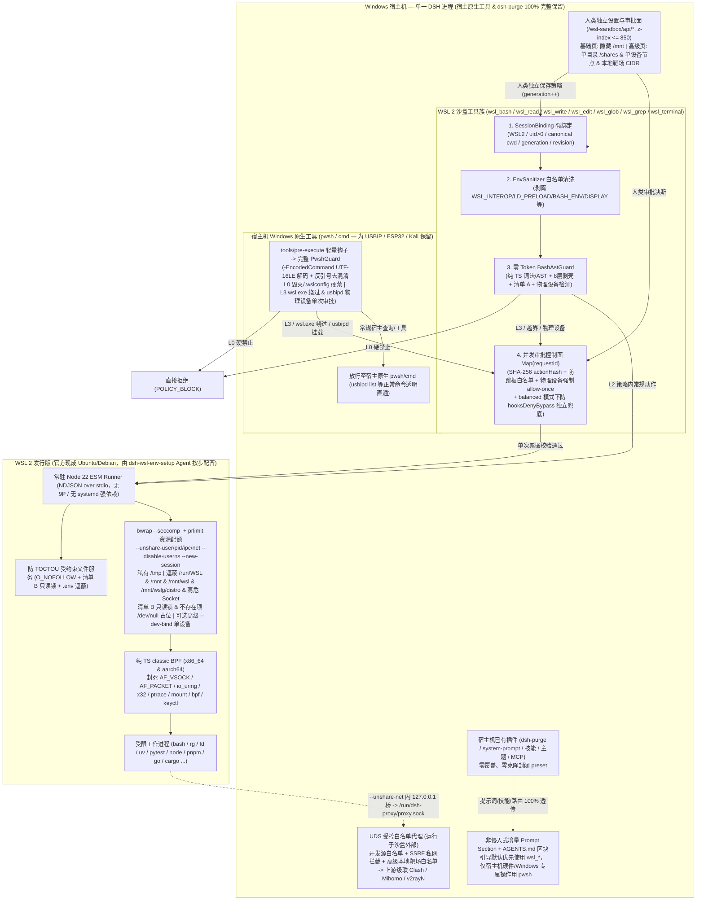

# DeepSeek Harness (DSH) WSL 2 后端与 Codex 级命令沙盒——完整工程规格书（v2.0 定稿 / v0.3.0 归档）

> **主页导航**：[**简体中文主页 (README.md)**](../README.md) | [**English Overview (README.en.md)**](../README.en.md)  
> **文档版本**：v2.0 锁定规格（经 `grill-me` 多轮决策锁定 Q1–Q18，对应已交付实现的 **`v0.3.0`**）  
> **同步记忆库**：所有可执行代码契约、接口签名、系统调用号表与错误矩阵已同步沉淀至 Trellis 规范树 [`.trellis/spec/`](../.trellis/spec/guides/index.md) 与已归档任务 PRD [`prd.md`](../.trellis/tasks/archive/11-23-dsh-wsl-sandbox/prd.md)  
> **便携技能包**：[`.agents/skills/dsh-wsl-env-setup/SKILL.md`](../.agents/skills/dsh-wsl-env-setup/SKILL.md) 已内置轻量化 WSL 2 环境引导建置技能包

---

## 一、18 项最终锁定决策总表（Q1–Q18）

| 编号 | 决策主题 | 最终定稿结论 |
| :--- | :--- | :--- |
| **Q1** | DSH 运行形态 | **同时支持** Windows Electron Desktop App (`desktop` profile) 与 CLI (`dsh web` / `dsh headless`)，以零原生编译的标准 DSH Cordis Bundle 交付 |
| **Q2** | WSL 2 发行版策略 | **双模式支持**：既支持全新官方现成发行版（如 `Ubuntu-24.04` / `dsh-sandbox`），也支持直接复用已有 WSL 2 发行版 |
| **Q3** | WSL 常驻 Runner 技术栈 | **纯 TypeScript / Node 22 ESM**（零交叉编译、零 `node-gyp`，与 DSH 及内置 Node 22 统一） |
| **Q4** | 与 `dsh-purge` 共存的审批权 | **`balanced`（默认，可切 `strict` / `trust-workspace`）**：`dsh-purge` 的提示词、技能、路由、自动重试 **100% 保留生效**；OS 内核硬隔离与 L0 硬禁止永不可绕过；L3 优先走 DSH 原生 `ctx.approval`，但检测到宿主钩子被 `dsh-purge` `hooksDenyBypass` 跳过时由本插件独立高危审批闸门兜底 |
| **Q5** | 结合国内环境的默认网络 | 沙盒内**始终保持 `--unshare-net`**（禁直连与抽象 Unix Socket），默认常开 **UDS 受控开发源白名单代理** + 自动/手动级联本机上游代理（Clash/Mihomo/v2rayN，兼容 NAT/mirrored）+ 国内镜像源 `--mirror cn`；白名单外域名走审批；设置页可一键切纯断网模式 |
| **Q6** | 对标 Codex 的环境档位 | **`core` / `standard` / `universal` 三档可选**（纯预编译二进制快装，支持 `--mirror cn` / `--proxy`） |
| **Q7** | `.env` / `.env.*` 密钥保护 | **默认深度 ≤ 3 自动遮蔽为空白只读**（`wsl_bash` 与 `wsl_fs` 同步），人类 UI 支持按项目单独放行 |
| **Q8** | Windows 跨盘共享策略 | **基础配置界面彻底隐藏任何 `/mnt` 全盘挂载入口**；仅在「高级选项」中允许人类手动按次开启单目录 `/shares/<alias>`（默认只读、一键撤权并强杀旧进程）；**完整保留 Windows Explorer 左侧「Linux」标签下由人类手动复制粘贴文件到 WSL 工作区的工作流** |
| **Q9** | 审批决策与防跳板白名单 | **4 档决策**（`allow-once` / `allow-session-rule` / `deny` / `deny-with-guidance`）+ POSIX & PowerShell 双黑名单禁用万能跳板沉淀 + 默认 60s 超时 fail-closed |
| **Q10** | Bash AST 解析器依赖 | **纯 TS 零原生编译完整 Bash 词法/AST 引擎为主 + 可选 WASM 挂点**，彻底规避 Electron ABI 冲突与 pnpm 11/12 `allowBuilds` 报错 |
| **Q11** | 沙盒包管理器缓存策略 | **可选**：支持「按工作区隔离持久化缓存卷（默认）」与「纯 `/tmp` 阅后即焚」两种模式，支持一键清理 |
| **Q12** | 工具接管形态（ESP32/USBIP/Kali） | **保留宿主机 Windows 原生工具 + 新增完整沙盒化 `wsl_*` 工具族**（`wsl_bash`/`wsl_read`/`wsl_write`/`wsl_edit`/`wsl_glob`/`wsl_grep`/`wsl_terminal`），既兼容 `usbipd-win`/ESP32/Kali 宿主机硬件混合流，又从结构上彻底杜绝与 DSH 核心服务的 Cordis 注册冲突 |
| **Q13** | 物理设备节点直通 & 自动降级 | 默认关闭任何物理设备；高级选项支持精确单节点 `--dev-bind` 白名单（`/dev/ttyUSB*`、`/dev/ttyACM*`、`/dev/bus/usb/NNN/NNN`）；**凡涉及物理设备操作（含烧录工具、`--dev-bind` 开启态、以及宿主 `usbipd bind/attach/detach`）一律强制降级为每次手动 `allow-once` 审批，严禁会话记忆自动放行** |
| **Q14** | 「优先用 WSL」提示词注入 | **双管齐下**：运行时通过 DSH 非侵入式 `ctx.systemPrompt` 增量 section API 注册（绝不覆盖 `dsh-purge` 的 `id: system-prompt`）+ 一键写入/更新项目 `AGENTS.md` WSL 优先指引区块 |
| **Q15** | 宿主 PowerShell 完整高危守卫 | 在 `tools/pre-execute` 为宿主机 `pwsh`/`cmd` 补齐**完整零 Token `PwshGuard`**（Base64 `-EncodedCommand` UTF-16LE 解码、反引号去混淆、L0 毁灭/改 `.wslconfig`/root WSL 硬禁、L3 `wsl.exe` 绕过拦截/删库/提权/下载执行/物理设备 `usbipd` 单次审批），正常宿主查询（`usbipd list`、`Get-PnpDevice`）与 `dsh-purge` 透明放行 |
| **Q16** | UDS 代理防 SSRF & 本地靶场 | **默认严禁转发任何私网/回环/元数据 IP**（`127.0.0.0/8`, `10/8`, `172.16/12`, `192.168/16`, `169.254/16`, `::1`, `fc00::/7`, `fe80::/10`）；高级选项支持人类手动添加本地实验 CIDR/端口白名单（供本地 Dev Server / 合法靶场联调，模型无权修改） |
| **Q17** | 实测验证边界 | 本机 Linux x86_64 完成全量 4 包实现 + **真实 Linux 内核 `bwrap + seccomp-bpf + prlimit + UDS 代理` 正反逃逸测试** + **模拟 `dsh-purge` 同装共存测试** + 交付 Windows 真实 WSL 2 一键真机验收脚本 |
| **Q18** | **笔记本零重构建与受控引导方案** | **不跑本地 Docker 镜像构建、不编译内核、不源码编译 Python**；交付「前置 `install-dsh-plugin.ps1` + **控制台预览 SHA-256 -> 开启受控引导通道（强制 1 探测 -> 2 `-DryRun` 确认卡片 -> 3 单次审批安装 -> 4 `doctor` 闭环自动关闸）**」双入口协同机制，默认 `L0` 锁死未授权安装/卸载，网络默认保持 `NAT` |

---

## 二、总体架构图与双工具并存信任边界

---

## 三、宿主机插件（`dsh-purge` 等）零冲突、不失效保障规格

详见可执行规范 [`.trellis/spec/plugin/coexistence.md`](../.trellis/spec/plugin/coexistence.md) 与 [`.trellis/spec/guides/host-plugin-coexistence.md`](../.trellis/spec/guides/host-plugin-coexistence.md)：

1. **零核心服务覆写（根治 `Big-Dao` Issue `#39`）**：[`cordis.patch.yml`](../cordis.patch.yml) **只做增量 `- insert:`**（采用单一包根入口 `id: dsh-wsl-sandbox`、`name: 'dsh-wsl-sandbox'`），**绝不禁用或覆盖** `system-prompt`、`fs-local`、`subprocess-local`、`sandbox-local`、`pwsh-local` 或任何内置 Agent Preset。
2. **零封闭 `preset-wsl` 隔绝**：与 `dsh-purge`、主题、压缩、MCP 插件共处同一宿主机进程与同一活跃 Preset，`dsh-purge` 的提示词改写、`postPrompt`（`order: 5100`）、技能库、自动重试 100% 原样生效。
3. **非侵入式提示词协作（Q14=A）**：使用 DSH 增量 section API 注册 `id: 'dsh-wsl-sandbox-routing'`（`order: 4200`），绝不覆写 `id: system-prompt`；同时提供 `upsertAgentsMdWslSection()` 安全追加/更新 `AGENTS.md` 标记块。
4. **`hooksDenyBypass` 下的安全双轨兜底（Q4=A）**：
   - 瀑布流礼让：非本插件工具请求在 `approval/request` 中一律 `return next()`；`tools/pre-execute` 只检查宿主 `pwsh`/`cmd` 调用，其余工具（含 `dsh-purge` 自定义工具、MCP）一律零干涉透传。
   - `balanced` 兜底：若宿主 `ctx.approval` 被 `dsh-purge` `hooksDenyBypass: true` 跳过或无人工凭证瞬时放行，对 L3 高危破坏、`wsl.exe` 绕过、物理设备、越界/陌生域名，自动切入本插件独立审批队列 `/wsl-sandbox/api/approvals/:id/decide`。
5. **零宿主入侵与零 `allowBuilds` 冲突**：纯 Node 22 ESM 零原生依赖（无 `node-gyp`），绝不触碰 `resources/app.asar`、`@deepseek-ai/*` 源码、`pnpm-workspace.yaml` 或其他插件的 `cordis.patch.yml`；UI 路由独占 `/wsl-sandbox/api/*`，CSS 类独占 `.dsh-wsl-sbx-*`，`z-index <= 850`（低于 `dsh-purge` 900/950 与宿主模态框 1000）。

---

## 四、内核硬隔离规格（`bwrap` + 纯 TS `seccomp-bpf` + `prlimit` + UDS 代理）

详见可执行规范 [`.trellis/spec/core/contracts.md`](../.trellis/spec/core/contracts.md)（核心模块 [`seccomp-bpf.ts`](../packages/core/src/seccomp-bpf.ts)、[`bwrap-builder.ts`](../packages/core/src/bwrap-builder.ts)、[`dangerous-paths.ts`](../packages/core/src/dangerous-paths.ts)、[`env-sanitizer.ts`](../packages/core/src/env-sanitizer.ts) 已按此规格对齐）：

- **命名空间**：`--unshare-user`、`--disable-userns`、`--unshare-pid`、`--unshare-ipc`、`--unshare-net`、`--new-session`（防 `TIOCSTI`）、`--die-with-parent`。
- **临时空间与 WSL 2 逃逸面**：私有 `--tmpfs /tmp --tmpfs /var/tmp`（绝不禁用 `/tmp`）；强制遮蔽 `/run/WSL`、`/mnt`、`/mnt/wsl`、`/mnt/wslg/distro`、`/tmp/.X11-unix`、`/mnt/wslg/.X11-unix`、`/mnt/wslg/PulseServer`；`readlink -f` 解析后 `--ro-bind /dev/null` 遮蔽 D-Bus / systemd private / Docker / Podman / containerd / cri-o / k3s / `$SSH_AUTH_SOCK` / `$GPG_AGENT_INFO`（探测异常 fail-closed）。
- **清单 B 工作区细粒度只读锁 & 防新建占位**：在 `--bind <workspaceRoot>` 之后叠加只读覆盖 `DANGEROUS_FILES`（`.gitconfig`, `.gitmodules`, `.bashrc`, `.bash_profile`, `.zshrc`, `.zprofile`, `.profile`, `.ripgreprc`, `.mcp.json`）与 `DANGEROUS_DIRECTORIES`（`.git/hooks`, `.git/config`, `.git/HEAD`, `.vscode`, `.idea`, `.claude/commands`, `.claude/agents`, `.agents`, `.codex`, `.gemini`, `.dsh`），对不存在项以 `/dev/null` 只读占位防新建投毒；深度 ≤ 3 自动遮蔽 `.env` / `.env.*`（豁免 `.env.example`/`.sample`/`.template`）。
- **纯 TS `seccomp-bpf`（`x86_64` & `aarch64`）**：
  - 严格校验 `AUDIT_ARCH`；`x86_64` 下封死 x32 ABI（`nr >= 0x4000_0000`）；
  - 无条件 `EPERM` 拦截 `io_uring_{setup,enter,register}`、`ptrace`、`process_vm_{readv,writev}`、`kcmp`、`mount`/`umount2`/`pivot_root`/`fsopen`/`fsmount`/`move_mount`/`open_tree`、`unshare`/`setns`/`chroot`、`bpf`、`kexec_load`/`kexec_file_load`、`init_module`/`finit_module`/`delete_module`、`add_key`/`request_key`/`keyctl`、`reboot`、`swapon`/`swapoff`；
  - `socket`/`socketpair` 检查 `arg0`（含高 32 位防 smuggling）：无条件封死 **`AF_VSOCK (40)`** 与 **`AF_PACKET (17)`**；纯断网模式下额外封死除 `AF_UNIX`/`AF_NETLINK` 外的全部协议族。
- **UDS 受控白名单代理 + 国内上游代理级联（Q5=B + Q16=A）**：
  - 沙盒内保持 `--unshare-net`，通过隔离 netns 内的本地回环桥转发至挂载的 `/run/dsh-proxy/proxy.sock`；
  - 外部 `UdsProxy` 校验开发源白名单（GitHub / npmjs / npmmirror / PyPI / 清华源 / crates.io / rsproxy / goproxy.cn / Ubuntu 镜像 / mise 等可配），支持级联本机 Clash/Mihomo/v2rayN（HTTP CONNECT / SOCKS5）；
  - 强制阻断所有私网/回环/链路本地/云元数据 IP（防 SSRF），仅放行高级选项中由人类手动配置的 `localLabCidrs` / `localLabPorts`。
- **资源防爆（`nsjail` 思路）**：`prlimit --nproc=256 --nofile=1024 --fsize=536870912` + 独立 `PGID` 超时/撤权 TERM→KILL 连根清理。

---

## 五、双引擎零 Token 命令审批系统规格（Bash + PowerShell + 物理设备降级）

1. **WSL 侧 `BashAstGuard`**（[`bash-ast-guard.ts`](../packages/core/src/bash-ast-guard.ts)）：
   - 纯 TS 零原生依赖词法/AST 解析：`$IFS` 归一化、64KB 长度上限、引号/转义/注释边界、`$()`/反引号/`<()`/`>()` 递归提取、重定向目标检测、8 层包装器递归剥壳（`sudo`/`doas`/`env`/`trap`/`eval`/`command`/`exec`/`nohup`/`nice`/`ionice`/`time`/`timeout`/`stdbuf`/`setsid`/`runuser`/`xargs`/嵌套 shell）。
   - L0 硬禁止：磁盘格式化擦除（`mkfs*`/`wipefs`/`mkswap`/`blkdiscard`/`shred`/`fdisk`/`parted` 写操作）、裸块设备写（`/dev/sd*`/`nvme*` 等）、电源/内核/挂载控制、Fork 炸弹、`rm` 删系统根/主目录、修改 `/etc/wsl.conf` 或 `/etc/fstab`、读 `gha-creds-*.json`。
   - L3 审批：`rm` 含 `-f`/`-r`/`-R`、`find -delete`/`-exec rm`、`git clean -fdx`、`git reset --hard`、`git checkout -- .`、`git push --force`、`git -C`/`--work-tree`/`--git-dir`/`git config` 敏感键、`| sh`/`| bash` 管道执行、越出 `workspaceRoot` 路径。
2. **宿主侧 `PwshGuard` 与微软官方 AST 解析器**（[`pwsh-guard.ts`](../packages/core/src/pwsh-guard.ts) & [`pwsh-system-parser.ts`](../packages/core/src/pwsh-system-parser.ts)）：
   - 结合微软官方 `[System.Management.Automation.Language.Parser]::ParseInput` / `ParseFile` 只读 AST Worker，自动解码 PowerShell **`-EncodedCommand` / `-enc` / `-e`（UTF-16LE Base64）**并递归复检、剥离反引号混淆（`` i`ex `` → `iex`、`` w`sl.exe `` → `wsl.exe`）、穿透 `pwsh -c` / `cmd /c` / `iex`。
   - L0 硬禁止：`Format-Volume`/`Clear-Disk`/`Initialize-Disk`/`Remove-Partition`/`diskpart`/`format.com`/`bcdedit`/`cipher /w`、`Stop-Computer`/`Restart-Computer`/`shutdown /s|/r`、`Set-MpPreference -DisableRealtimeMonitoring`、`vssadmin delete shadows`、`wevtutil cl`、`reg save HKLM\SAM|SYSTEM|SECURITY`、LSASS dump、修改 `.wslconfig`/`wsl.conf`/`fstab`、`wsl --import|--unregister|--shutdown|--set-default|--terminate|--mount`、`wsl -u root`。
   - L3 审批：宿主 `pwsh` 偷调 `wsl.exe`/`bash.exe` 绕过沙盒、`Remove-Item -Recurse/-Force`、`cmd /c rd /s /q`、`reg delete`、`Set-ExecutionPolicy Bypass|Unrestricted`、`Start-Process -Verb RunAs`、`schtasks /create`/`Register-ScheduledTask`、`New-Service`/`sc create|delete`、`icacls`/`takeown`/`Set-Acl`、`iwr|iex`、`certutil -urlcache`、`bitsadmin /transfer`。
   - 友好直通：`usbipd list` / `usbipd state`、`Get-PnpDevice` 等只读查询透明放行。
3. **物理设备操作自动强制降级为单次手动审批（Q13）**：
   - 凡命中：高级选项已开启 `--dev-bind` 设备节点、WSL 命令触及 `/dev/ttyUSB*`/`/dev/ttyACM*`/`/dev/bus/usb/*` 或调用 `esptool`/`idf.py flash|monitor|erase-flash|efuse`/`openocd`/`avrdude`/`st-flash`/`dfu-util`/`minicom`/`picocom`/`pio upload`，或宿主调用 `usbipd bind|unbind|attach|detach`——**`touchesPhysicalDevice = true`，强制禁用会话记忆放行，每次必须人类手动 `allow-once`**！
4. **并发单次审批控制面（[`approval-controller.ts`](../packages/core/src/approval-controller.ts)）**：
   - `Map<requestId, PendingEntry>` 彻底消除并发 `REVIEW_BUSY` 冲突；
   - 不可变 `SHA-256 actionHash` 绑定 `{ binding (含 generation/revision), action }` + 短 TTL（默认 60s）+ 一次性原子消费 `consume()`；
   - POSIX + PowerShell 合并 `BANNED_PREFIX_SUGGESTIONS` 硬黑名单（永不允许将 `bash`/`sh`/`env`/`git`/`node -e`/`python -c`/`pwsh`/`cmd`/`wsl`/`iex`/`Start-Process` 等沉淀为会话免审前缀）；
   - 策略或目录撤权调用 `invalidate()` 立即 `generation++`、清空会话规则、批量 `abort()` 全部待审批请求并强杀旧进程树。

---

## 六、笔记本零重构建建环境方案（Q18：Agent 引导提示词 + 二进制快装 + Doctor 闭环）

针对**笔记本无法承受本地 Docker 镜像构建或内核/源码编译**的现实约束，彻底取消 Dockerfile 重构建，改用 **三件套轻量建环境体系**（详见 [`.trellis/spec/bootstrap/toolchains.md`](../.trellis/spec/bootstrap/toolchains.md) 与 [`wsl-env-setup.md`](../packages/bootstrap/prompts/wsl-env-setup.md)）：

1. **官方现成 WSL 2 发行版**：直接复用现有 Ubuntu 26.04/24.04 / Debian / Fedora / `archlinux` / WSL Manager 迁移实例，或通过微软官方命令 `wsl.exe --install -d Ubuntu-26.04` 一键拉起干净发行版。
2. **专用 Agent 引导建环境 Skill & 提示词（[`dsh-wsl-env-setup`](../.agents/skills/dsh-wsl-env-setup/SKILL.md)）与宿主 `pwsh-hook` 顺序门禁**：
   - **常态 `L0` 锁死**：未在控制面手动开启「受控 AI 初始化引导通道」前，AI 私自调用安装/staging/卸载脚本直接触发 `L0 deny`；
   - **开启后严格四步强制审批**：
     - **步骤 1/4 只读探测**：`wsl.exe -l -v` + 只读 Lxss 注册表探测，确认目标发行版、档位（`core` ~350MB / `standard` ~1.2GB / `universal` ~3.5GB）与镜像/代理（默认推荐保持 WSL `NAT`）；
     - **步骤 2/4 `-DryRun` 预览与固定格式 confirmation card**：必须先经单次审批运行 `-DryRun` 预览并向人类输出固定格式《安装脚本与变更预览卡片》确认，未执行前真实安装/staging/`--install`/`--terminate` 一律 `L0 deny`；
     - **步骤 3/4 纯预编译二进制分步单次审批安装**（支持 `install-dsh-plugin.ps1 -NonInteractive -Step ...` 与 `provision-wsl.sh --step ...`）；
     - **步骤 4/4 `dsh-wsl-doctor --json` 强制验收门禁**：逐项核验 `WSL 2`、`uid > 0`、`bwrap`、`unprivileged userns`、`seccomp` (`AF_VSOCK` & `io_uring`)、逃逸面遮蔽与 Codex 工具链矩阵，首次绑定就绪后引导通道自动关闸。

---

## 七、v0.3.0 工程实现与验收状态归档

以上 Q1–Q18 架构与安全设计已全部在 **`v0.3.0`** 完整落地并通过自动化验证：

1. **`packages/core`**：完整交付 `errors.ts`、`binding.ts`、`env-sanitizer.ts`、`dangerous-paths.ts`、`seccomp-bpf.ts`、`bwrap-builder.ts`、`bash-ast-guard.ts`、`pwsh-system-parser.ts`、`pwsh-guard.ts`、`approval-controller.ts`、`uds-proxy.ts`、`protocol.ts`、`logger.ts`、`node-runtime.ts`。
2. **`packages/wsl-runner`**：完整交付常驻 NDJSON `main.ts`、`probe.ts`、`fs-service.ts`、`proc-manager.ts`、`pty-manager.ts` 与 `hygiene.ts`。
3. **`packages/dsh-plugin`**：完整交付 7 个 `wsl_*` 工具与会话管理器（`tools.ts`）、支持 DIY 发行版与自动 staging 的 `wsl-discovery.ts`/`wsl-transport.ts`、`prompt-injector.ts`、`pwsh-hook.ts`、`approval-bridge.ts`、`config-store.ts`、带 DNS Rebinding/CSRF 防护的 `web-api.ts`、以及内置中英文概览切换的 `web-ui-entry.ts` & `client-src.js`。
4. **`packages/bootstrap` & 测试验收**：完整交付 `provision-wsl.sh`、`install-dsh-plugin.ps1`、`uninstall-dsh-plugin.ps1`、`doctor.ts`（`dsh-wsl-doctor`）及 `tests/windows-wsl-verify/verify-wsl2.ps1`；全库具备 **81 项自动化测试**（Windows 宿主防误触锁下 71 通过、0 失败；WSL 2 Linux 内核下 81 项全量覆盖真实 `bwrap + seccomp-bpf` 与 `dsh-purge` 共存）及 **246 条零执行红队门禁向量**（30 + 24 + 192，0 漏报 / 0 误报）。
